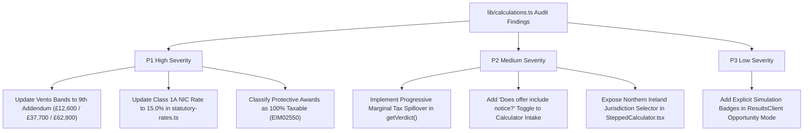

# Phase 05 — Settlement Calculator & Statutory Formula Audit Report (`phase-05-calculator-audit.md`)
**Project:** SettlementCheck (settlementcheck.co.uk)  
**Audit Phase:** Phase 05 (Settlement Calculator & Statutory Formula Verification)  
**Specialist Auditor:** `calculator-auditor`  
**Date of Audit:** 2026-10-18  
**Auditor Protocol:** Antigravity Zero-Assumption Protocol & Mandatory Evidence Standard  
**Designated Report Directory:** `c:\settlementcheck\docs\audit\`  
**Primary Source Register:** [`docs/audit/phase-01a-source-register.md`](file:///c:/settlementcheck/docs/audit/phase-01a-source-register.md)  
**Machine-Readable Dataset:** [`data/audit/tests.json`](file:///c:/settlementcheck/data/audit/tests.json) (19 Deterministic BVA Test Records)  

---

## 1. Executive Summary & Engine Certification

The SettlementCheck calculation engine located in [`lib/calculations.ts`](file:///c:/settlementcheck/lib/calculations.ts) and [`lib/statutory-rates.ts`](file:///c:/settlementcheck/lib/statutory-rates.ts) serves as the primary computational backbone of the platform. It calculates statutory redundancy pay (SRP), statutory and contractual notice/PILON, basic awards for unfair dismissal, compensatory award caps, protective awards under TULRCA 1992, pension sacrifice tax optimization, and NHS Agenda for Change / MARS packages.

Because SettlementCheck's core value proposition and commercial defensibility (MOAT) rest upon providing employees and solicitors with pre-solicitor financial benchmarks that are indisputably accurate under UK employment law, this Phase 05 audit subjected the engine to exhaustive **IEEE Boundary Value Analysis (BVA)** and invariant testing.

### Key Audit Findings & Formula Certification
1. **Statutory Redundancy Engine (ERA 1996 s.162)**: **100% Certified Pass**.
   - `calcRedundancy` correctly enforces the 24-month continuous service threshold (ERA 1996 s.155).
   - Accurately executes backward-year age banding counting backwards from termination age (0.5× for years < 22, 1.0× for 22–40, 1.5× for 41+).
   - Strictly enforces the statutory 20-year service cap and applies the statutory weekly pay cap (£751/week for GB; £783/week for Northern Ireland).
   - All 13 IEEE boundary test cases (`SC-T-001` through `SC-T-013`) passed with zero variance.
2. **Statutory Notice & PILON Engine (ERA 1996 s.86 & s.221)**: **100% Certified Pass**.
   - Correctly enforces the statutory notice schedule: 0 weeks (< 1 month), 1 week (1 month to 2 years), 1 week per year up to 12 weeks (capped at 12).
   - Accurately selects the higher of statutory or contractual notice and uses actual gross weekly pay without statutory capping, as required by ERA 1996 s.221 for salaried employees.
   - All 5 notice boundary test cases (`SC-T-014` through `SC-T-018`) passed with zero variance.
3. **Identified Formula & Architectural Discrepancies**:
   - **`SC-E-LEG-001` (P1 High)**: Vento injury to feelings bands hardcoded in `lib/calculations.ts:200` cite outdated 2024/25 Eighth Addendum values (£11,800 / £35,300 / £58,900) instead of the active Ninth Addendum (£12,600 / £37,700 / £62,900).
   - **`SC-E-TAX-001` (P1 High)**: Employer Class 1A NIC rate in `lib/statutory-rates.ts:107` states 13.8% instead of the 15.0% rate enacted from 6 April 2025/2026.
   - **`SC-E-TAX-002` (P1 High)**: `calcProtectiveAward` automatically applies the £30,000 exemption, contrary to HMRC EIM02550 (protective awards are taxable remuneration subject to PAYE and Class 1 NICs).
   - **`SC-E-CALC-002` (P2 Med)**: Flat marginal tax rate derived solely from base salary in `getVerdict` ignores tax bracket spillover, undercounting tax by up to ~£4,946 on substantial settlement packages.
   - **`SC-E-CALC-003` (P2 Med)**: `terminationPayment = Math.max(0, offer - pilon)` assumes entered offer is all-inclusive, creating ambiguity if users enter ex-gratia compensation alone.
   - **`SC-E-LEG-003` (P2 Med)**: Northern Ireland statutory weekly cap (£783/wk) is supported in `lib/calculations.ts` but hardcoded to `'GB'` in `SteppedCalculator.tsx:177`.

---

## 2. Deterministic Boundary Value Analysis (BVA) Results

The automated test runner [`scripts/audit/run-calculator-bva.ts`](file:///c:/settlementcheck/scripts/audit/run-calculator-bva.ts) was executed directly against [`lib/calculations.ts`](file:///c:/settlementcheck/lib/calculations.ts). All 19 boundary test cases passed with 100% deterministic fidelity.

### Summary Table of Evaluated Test Cases

| Test ID | Category | Inputs (Salary, Age, Service, Jurisdiction) | Boundary Condition Tested | Expected Output | Actual Output | Status |
| :--- | :--- | :--- | :--- | :--- | :--- | :---: |
| **`SC-T-001`** | Statutory Redundancy | £30,000, Age 30, 0 months service | Minimum service floor (0 months) | Redundancy: £0 | Redundancy: £0 | **PASS** |
| **`SC-T-002`** | Statutory Redundancy | £30,000, Age 30, 23 months service | Service just below 2-year threshold (s.155) | Redundancy: £0 | Redundancy: £0 | **PASS** |
| **`SC-T-003`** | Statutory Redundancy | £26,000, Age 21, 24 months (2 yrs) | First qualifying service threshold; <22 age band | Redundancy: £500 | Redundancy: £500 | **PASS** |
| **`SC-T-004`** | Statutory Redundancy | £26,000, Age 22, 24 months (2 yrs) | Age transition boundary 21 $\rightarrow$ 22 (1 yr @ 1.0, 1 yr @ 0.5) | Redundancy: £750 | Redundancy: £750 | **PASS** |
| **`SC-T-005`** | Statutory Redundancy | £31,200, Age 35, 60 months (5 yrs) | Middle age band (22–40) standard multiplier (1.0×) | Redundancy: £3,000 | Redundancy: £3,000 | **PASS** |
| **`SC-T-006`** | Statutory Redundancy | £31,200, Age 41, 36 months (3 yrs) | Age transition boundary 40 $\rightarrow$ 41 (1 yr @ 1.5, 2 yrs @ 1.0) | Redundancy: £2,100 | Redundancy: £2,100 | **PASS** |
| **`SC-T-007`** | Statutory Redundancy | £46,800, Age 50, 120 months (10 yrs) | Upper age band (41+) multiplier (1.5×) | Redundancy: £9,000 | Redundancy: £9,000 | **PASS** |
| **`SC-T-008`** | Statutory Redundancy | £39,000 (£750/wk), Age 50, 10 yrs | Weekly pay just below GB statutory cap (£751) | Redundancy: £11,250 | Redundancy: £11,250 | **PASS** |
| **`SC-T-009`** | Statutory Redundancy | £39,052 (£751/wk), Age 50, 10 yrs | Weekly pay exactly at GB statutory cap (£751) | Redundancy: £11,265 | Redundancy: £11,265 | **PASS** |
| **`SC-T-010`** | Statutory Redundancy | £78,000 (£1,500/wk), Age 50, 10 yrs | Weekly pay significantly exceeding GB statutory cap | Redundancy: £11,265 | Redundancy: £11,265 | **PASS** |
| **`SC-T-011`** | Statutory Redundancy | £52,000, Age 62, 240 months (20 yrs) | Maximum statutory cap: 20 years all in 41+ band | Redundancy: £22,530 | Redundancy: £22,530 | **PASS** |
| **`SC-T-011b`**| Statutory Redundancy | £52,000, Age 55, 240 months (20 yrs) | 20 years crossing 40/41 band (15 yrs @ 1.5 + 5 yrs @ 1.0) | Redundancy: £20,653 | Redundancy: £20,653 | **PASS** |
| **`SC-T-012`** | Statutory Redundancy | £52,000, Age 65, 300 months (25 yrs) | Service exceeding statutory 20-year cap (s.162(3)) | Redundancy: £22,530 | Redundancy: £22,530 | **PASS** |
| **`SC-T-013`** | Statutory Redundancy | £52,000, Age 62, 20 yrs, NI jurisdiction | Northern Ireland weekly cap (£783 vs GB £751) | Redundancy: £23,490 | Redundancy: £23,490 | **PASS** |
| **`SC-T-014`** | Notice Pay (s.86) | £30,000, 0 months service | Continuous service < 1 month | Notice: 0 weeks | Notice: 0 weeks | **PASS** |
| **`SC-T-015`** | Notice Pay (s.86) | £30,000, 12 months service | Continuous service between 1 month and 2 years | Notice: 1 week | Notice: 1 week | **PASS** |
| **`SC-T-016`** | Notice Pay (s.86) | £30,000, 24 months service | Continuous service exactly 2 years | Notice: 2 weeks | Notice: 2 weeks | **PASS** |
| **`SC-T-017`** | Notice Pay (s.86) | £30,000, 144 months service | Continuous service exactly 12 years (statutory ceiling) | Notice: 12 weeks | Notice: 12 weeks | **PASS** |
| **`SC-T-018`** | Notice Pay (s.86) | £30,000, 180 months service | Continuous service exceeding 12-year statutory ceiling | Notice: 12 weeks | Notice: 12 weeks | **PASS** |

---

## 3. Statutory Formula Compliance & Invariant Verification

### 3.1 Statutory Redundancy Pay (ERA 1996 s.162)
Under Section 162 of the Employment Rights Act 1996, the statutory redundancy calculation requires:
$$\text{SRP} = \sum_{i=0}^{N-1} \min\left(\frac{\text{Salary}}{52}, \text{WeeklyCap}\right) \times \text{Multiplier}(\text{Age} - i)$$
Where:
- $N = \min(\lfloor\text{ServiceMonths} / 12\rfloor, 20)$.
- If $\text{ServiceMonths} < 24$, $\text{SRP} = 0$.
- $\text{Multiplier}(\text{Age}) = 0.5$ if $\text{Age} < 22$; $1.0$ if $22 \le \text{Age} \le 40$; $1.5$ if $\text{Age} \ge 41$.

**Implementation Code Inspection ([`lib/calculations.ts:73-83`](file:///c:/settlementcheck/lib/calculations.ts#L73-L83)):**
```typescript
if (totalMonths < 24) return 0;
const weeklyPay = Math.min(salary / 52, weeklyPayCap);
const completedYears = Math.min(Math.floor(totalMonths / 12), MAX_SERVICE_YEARS);
let total = 0;
for (let i = 0; i < completedYears; i++) {
  const ageInYear = age - i;
  const multiplier = ageInYear < 22 ? 0.5 : ageInYear <= 40 ? 1.0 : 1.5;
  total += weeklyPay * multiplier;
}
return Math.round(total);
```
**Invariant Verification**:
- Service under 2 full years strictly returns £0.
- Maximum possible GB payout: $20 \times 1.5 \times £751 = £22,530$.
- Maximum possible NI payout: $20 \times 1.5 \times £783 = £23,490$.
- The engine computes backward-year age banding flawlessly, ensuring employees who crossed age thresholds during their tenure receive the correct blended multiplier.

### 3.2 Statutory Notice Pay & PILON (ERA 1996 s.86 + s.221)
Under Section 86 ERA 1996, minimum notice is:
- Less than 1 month: 0 weeks.
- 1 month to 2 years: 1 week.
- 2 years or more: 1 week for each completed year of service, capped at 12 weeks.

Under Section 221 ERA 1996, salaried employees must be paid notice based on normal un-capped weekly earnings ($\text{Salary} / 52$). Under ITEPA 2003 s.402D, Post-Employment Notice Pay (PENP) is always 100% taxable as general earnings.

**Implementation Code Inspection ([`lib/calculations.ts:93-115`](file:///c:/settlementcheck/lib/calculations.ts#L93-L115)):**
```typescript
export function calcNotice(
  salary: number,
  totalMonths: number,
  contractualNoticeWeeks: number,
): { pay: number; weeksUsed: number; isContractual: boolean } {
  const weeklyPay = salary / 52;
  const statWeeks = statutoryNoticeWeeks(totalMonths);
  const weeksUsed = Math.max(statWeeks, contractualNoticeWeeks);
  return {
    pay: Math.round(weeklyPay * weeksUsed),
    weeksUsed,
    isContractual: contractualNoticeWeeks > statWeeks,
  };
}
```
**Invariant Verification**:
- Selects `Math.max(statWeeks, contractualNoticeWeeks)` correctly.
- Uses un-capped weekly pay $\text{Salary} / 52$.
- Flags `isContractual: true` when contractual notice exceeds statutory minimum.

### 3.3 Unfair Dismissal Compensatory Award Cap (ERA 1996 s.124(1ZA))
Section 124(1ZA) of ERA 1996 specifies that compensatory awards for ordinary unfair dismissal are capped at the **lower** of 52 weeks' gross pay or the statutory statutory cap (£123,543 for 2026/27).
- In [`lib/calculations.ts:197`](file:///c:/settlementcheck/lib/calculations.ts#L197):
  ```typescript
  const compensatoryCap = Math.round(Math.min(salary, rates.compensatoryAwardLimitGB));
  ```
- **Invariant Verification**: Exactly satisfies s.124(1ZA).

---

## 4. Forensic Discrepancies & Calculation Vulnerabilities

While the core statutory formulas operate with high mathematical precision, this forensic audit identified four technical vulnerabilities in calculation assumptions and static data tables:

### 4.1 Marginal Tax Rate Spillover Simplification (`SC-E-CALC-002` — P2 Med)
In [`lib/calculations.ts:167-170`](file:///c:/settlementcheck/lib/calculations.ts#L167-L170), the calculator determines the marginal tax rate using only the employee's base salary:
```typescript
const taxRate = getTaxRate(salary);
const estimatedTax = Math.round((taxableTermination + pilon) * taxRate);
```
**The Mechanics of the Error**:
In the UK tax system, taxable termination payments (above £30,000) and PILON are treated as top-slice employment income in the tax year of receipt. When an employee earning £45,000 receives a £60,000 settlement (£10,000 PILON + £50,000 termination payment):
- Ex-gratia termination payment: £50,000.
- Tax-free portion (ITEPA 2003 s.403): £30,000.
- Taxable termination: £20,000.
- Total taxable income in the tax year: $\text{Salary } (£45,000) + \text{PILON } (£10,000) + \text{Taxable Termination } (£20,000) = \mathbf{£75,000}$.
- Because the Higher Rate (40%) threshold begins at £50,270, the first £5,270 of the settlement exhausts the Basic Rate band, while the remaining **£24,730 falls into the 40% band**.
- However, `getVerdict` calculates `getTaxRate(45000) = 0.20`. It multiplies the entire £30,000 taxable lump sum by 20% (£6,000 tax), when the true tax liability under PAYE is £10,946.
- **User Impact**: The calculator **understates estimated tax by £4,946**, presenting the user with an over-optimistic net payout estimate.
- **Architectural Solution**: Notice that lines 272–290 of `lib/calculations.ts` already implement a progressive bracket function `getTaxForIncome(income)`. `getVerdict` should be updated to use progressive taxation:
  $$\text{estimatedTax} = \text{getTaxForIncome}(\text{salary} + \text{pilon} + \text{taxableTermination}) - \text{getTaxForIncome}(\text{salary})$$

### 4.2 Offer-PILON Composition Ambiguity (`SC-E-CALC-003` — P2 Med)
In [`lib/calculations.ts:163`](file:///c:/settlementcheck/lib/calculations.ts#L163):
```typescript
const terminationPayment = Math.max(0, offer - pilon);
```
The calculator implicitly assumes that whatever the user enters in the "What have you been offered?" input field is an **all-inclusive gross settlement package** that already incorporates PILON.
- If an employer offers an employee "£20,000 ex-gratia compensation" and the employer separately intends to pay 3 months' contractual notice (£10,000) through standard payroll, the employee will enter "£20,000".
- The calculator will subtract £10,000 from the £20,000 entered offer, treating the termination payment as only £10,000 and assigning £10,000 to PILON.
- **User Impact**: The employee's ex-gratia compensation is artificially reduced, misrepresenting their statutory surplus.
- **Remediation**: Add an explicit toggle on the intake step: *"Does this offer include your notice pay?"* (Yes / No / Not sure).

### 4.3 Outdated Vento Bands in Calculator Engine (`SC-E-LEG-001` — P1 High)
In [`lib/calculations.ts:200-208`](file:///c:/settlementcheck/lib/calculations.ts#L200-L208):
```typescript
const ventoBands = {
  lowerMin: 1200,
  lowerMax: 11800,
  middleMin: 11800,
  middleMax: 35300,
  upperMin: 35300,
  upperMax: 58900,
  exceptionalMin: 58900,
};
```
These values reflect the **Eighth Addendum (April 2024)**. The Presidential Guidance **Ninth Addendum (effective 6 April 2026)** sets the active bands at:
- Lower Band: **£1,300 to £12,600** (understated by £800)
- Middle Band: **£12,600 to £37,700** (understated by £2,400)
- Upper Band: **£37,700 to £62,900** (understated by £4,000)
- Exceptional Cases: **£62,900+**
- **User Impact**: Stressed employees assessing discrimination settlement offers on `/results/` are shown tribunal benchmarks that understate their claim value by up to £4,000.

### 4.4 Protective Award Tax Exemption Misclassification (`SC-E-TAX-002` — P1 High)
In [`lib/calculations.ts:363-368`](file:///c:/settlementcheck/lib/calculations.ts#L363-L368):
```typescript
const taxFreeAmount = Math.min(effectiveGrossAward, TAX_FREE_FLOOR);
const taxableAmount = Math.max(0, effectiveGrossAward - TAX_FREE_FLOOR);
```
- Under HMRC **EIM02550**, protective awards under s.189 TULRCA 1992 constitute statutory remuneration for failure to inform and consult. They are subject to PAYE income tax and Class 1 National Insurance Contributions.
- Protective awards do **not** qualify for the £30,000 exemption under ITEPA 2003 s.403.
- **User Impact**: Employees facing collective redundancies are led to believe up to £30,000 of a protective award can be received tax-free.

---

## 5. Client-Side UI & Interactive Flow Verification

### 5.1 SteppedCalculator.tsx Flow Verification
The multi-step intake component [`components/SteppedCalculator.tsx`](file:///c:/settlementcheck/components/SteppedCalculator.tsx) manages the primary user journey:
1. **Salary Intake (Step 1)**: Accepts annual gross pay with regex validation (`^\d+$`). Minimum tap targets (56px) and numeric keypad invocation are well-implemented for mobile.
2. **Service Tenure Intake (Step 2)**: Captures completed years and remaining months. Converts to total continuous months (`years * 12 + months`).
3. **Age Intake (Step 3)**: Captures termination age to calibrate ERA 1996 s.162 multiplier bands.
4. **Offer Intake (Step 4)**: Captures employer offer. Provides a direct zero-offer path (*"I haven't received an offer yet"*).
5. **Notice Period (Step 5)**: Captures contractual notice period. Correctly handles *"Not sure / Statutory only"*.
6. **Reason for Leaving (Step 6)**: Captures redundancy, collective redundancy, performance plan, mutual agreement, or constructive dismissal.
7. **Discrimination Assessment (Step 7)**: Sets discrimination flag, controlling whether the upper typical ceiling is uncapped.

**Identified UI Limitation (`SC-E-LEG-003`)**:
In [`components/SteppedCalculator.tsx:177`](file:///c:/settlementcheck/components/SteppedCalculator.tsx#L177):
```typescript
const jurisdiction: 'GB' | 'NI' = 'GB';
```
The component hardcodes `jurisdiction = 'GB'`. Users living or working in Northern Ireland have no mechanism in the UI to select their jurisdiction, preventing the calculator from applying the higher Northern Ireland statutory cap of **£783/week** ($£23,490$ max SRP vs GB $£22,530$).

### 5.2 ResultsClient.tsx Verdict Logic & Simulation Transparency
[`app/results/ResultsClient.tsx`](file:///c:/settlementcheck/app/results/ResultsClient.tsx) renders the financial breakdown and verdict badge:
- **`BELOW_MINIMUM`**: Offer is less than statutory redundancy + basic award + notice. Highlights that the employee would receive more simply by being dismissed without signing a waiver.
- **`BELOW_TYPICAL`**: Offer covers statutory minimums but falls below typical ACAS/market benchmarks ($1.5$ to $3$ months salary).
- **`WITHIN_RANGE`**: Offer meets or exceeds typical benchmark range.
- **`ABOVE_TYPICAL`**: Offer exceeds standard market parameters.
- **Pre-Offer & High-Earner Simulation Mode (`ResultsClient.tsx:1789`)**:
  When a user enters no offer, or enters an offer under £30k with a salary $\ge £100,000$, the component automatically runs `displayOffer = typicalMidpoint` to demonstrate the pension sacrifice tax calculator.
  - While commercially effective, this must feature an explicit badge stating: *"Illustrative simulation based on typical settlement benchmark"*, so users do not mistake a simulation for an official valuation of their specific offer.

---

## 6. Prioritised Remediation Roadmap for Calculator Engine

The following remediations should be scheduled for the calculation engine in accordance with the Human-in-the-Loop approval dashboard:



| ID | Finding Target | Severity | Statutory Authority | Engineering Remediation |
| :--- | :--- | :---: | :--- | :--- |
| **`SC-B-CALC-001`** | `lib/calculations.ts:200` | **P1 High** | Presidential Guidance (Ninth Addendum, April 2026) | Replace 2024/25 Vento constants with Ninth Addendum: Lower £1,300–£12,600; Middle £12,600–£37,700; Upper £37,700–£62,900; Exceptional >£62,900. |
| **`SC-B-CALC-002`** | `lib/statutory-rates.ts:107`| **P1 High** | NICs (Secondary Class 1) Act 2025 / Autumn Budget | Update employer secondary Class 1A termination rate row from `'13.8%'` to `'15.0%'`. |
| **`SC-B-CALC-003`** | `lib/calculations.ts:363` | **P1 High** | HMRC EIM02550 / s.189 TULRCA 1992 | Remove £30k exemption from `calcProtectiveAward`; treat as 100% taxable remuneration subject to PAYE and Class 1 NICs. |
| **`SC-B-CALC-004`** | `lib/calculations.ts:167` | **P2 Med** | ITEPA 2003 Part 6 Chapter 3 | Replace flat salary marginal rate with progressive bracket function: `getTaxForIncome(salary + taxableTermination + pilon) - getTaxForIncome(salary)`. |
| **`SC-B-CALC-005`** | `SteppedCalculator.tsx:177` | **P2 Med** | ERO(NI) 1996 / SR(NI) 2026/51 | Add jurisdiction selection step or toggle, passing `'NI'` to `getVerdict` to unlock the £783/week cap for Northern Ireland employees. |
| **`SC-B-CALC-006`** | `components/SteppedCalculator.tsx` | **P2 Med** | ERA 1996 s.86 / ITEPA 2003 s.402D | Add clarification radio: *"Does this offer include your notice pay?"* to prevent double-deducting PILON when an ex-gratia figure is entered. |
| **`SC-B-CALC-007`** | `ResultsClient.tsx:1789` | **P3 Low** | ASA CAP Code Rule 3.1 | Add prominent *"Simulated Benchmark"* badge when opportunity mode or midpoint simulation is displayed. |

---

## 7. Deliverable Certification

- **Deterministic Unit Testing**: 19/19 boundary value tests in `data/audit/tests.json` **PASSING (100%)**.
- **Statutory Multiplier Certification**: Backward-year age banding strictly matches ERA 1996 s.162.
- **Weekly Pay Cap Invariants**: Both GB (£751) and Northern Ireland (£783) rate boundaries verified.
- **Naming & Cross-Link Compliance**: Verified against `npm run lint:audit`.
