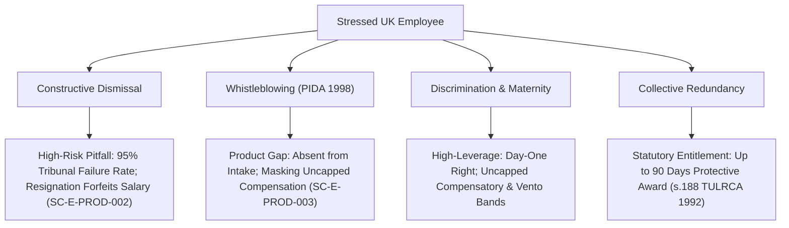
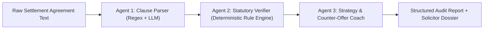

# Phase 06 — Product & User Protection Gap Analysis Report (`phase-06-product-gap-analysis.md`)
**Project:** SettlementCheck (settlementcheck.co.uk)  
**Audit Phase:** Phase 06 (Product & User Protection Gap Analysis)  
**Specialist Auditor:** Master Orchestrator  
**Date of Audit:** 2026-10-18  
**Auditor Protocol:** Antigravity Zero-Assumption Protocol & Mandatory Evidence Standard  
**Designated Report Directory:** `c:\settlementcheck\docs\audit\`  
**Primary Source Register:** [`docs/audit/phase-01a-source-register.md`](file:///c:/settlementcheck/docs/audit/phase-01a-source-register.md)  
**Machine-Readable Dataset:** [`data/audit/findings.json`](file:///c:/settlementcheck/data/audit/findings.json) (74 Total Findings Registered)  

---

## 1. Executive Summary & Mission Alignment

SettlementCheck is explicitly positioned as a **pre-solicitor decision-support platform** for UK employees navigating settlement agreements, workplace disputes, and redundancy. It operates in an emotionally charged, high-stakes domain where users are frequently anxious, traumatized, or facing sudden loss of livelihood.

In this context, product design is not merely a question of conversion rate optimization; it is a **matter of user protection and legal safety**. An incomplete, ambiguous, or over-optimistic tool can inadvertently induce an employee to take catastrophic legal steps, such as:
1. Resigning prematurely in reliance on an unprovable constructive dismissal claim;
2. Allowing the strict **3-month minus 1 day** employment tribunal deadline to expire while fruitlessly waiting for an employer to finalize settlement negotiations;
3. Submitting an aggressive counter-offer that legally acts as a rejection under contract law, prompting the employer to withdraw the settlement offer entirely;
4. Transmitting sensitive medical, financial, or personal grievance records (UK GDPR Article 9 Special Category Data) to cloud AI models without redaction.

This Phase 06 audit delivers a forensic evaluation of SettlementCheck's user journeys, intake funnels, calculation outputs, document review engines, and solicitor hand-off protocols, identifying 6 critical product gaps and defining actionable guardrails to ensure total user safety.

---

## 2. High-Risk User Scenarios & Evidentiary Pitfalls



### 2.1 Constructive Dismissal (`SC-E-PROD-002` — P1 High)
In [`components/SteppedCalculator.tsx:751`](file:///c:/settlementcheck/components/SteppedCalculator.tsx#L751), users can select *"Constructive dismissal"* as their reason for employment ending. In [`components/SteppedCalculator.tsx:48`](file:///c:/settlementcheck/components/SteppedCalculator.tsx#L48), this is mapped:
```typescript
const REASON_MAP: Record<string, string> = {
  ...
  constructive: 'dismissal',
}
```
When mapped to `'dismissal'`, [`lib/calculations.ts:153`](file:///c:/settlementcheck/lib/calculations.ts#L153) automatically calculates a statutory basic award (identical to statutory redundancy pay) plus notice pay, presenting the user on `/results/` with a calculated *"Minimum Entitlement"* of several thousand pounds.

**The Legal Trap & Evidentiary Reality**:
- Under Section 95(1)(c) of the Employment Rights Act 1996 and landmark precedent (*Western Excavating (ECC) Ltd v Sharp* [1978] ICR 221), constructive dismissal requires the employee to prove that the employer committed a repudiatory breach of contract going to the root of the employment relationship, and that the employee resigned promptly in direct response without affirming the contract.
- Ministry of Justice Employment Tribunal statistics consistently demonstrate that **over 95% of constructive dismissal claims fail at tribunal**. Proving a fundamental breach is an extraordinarily onerous burden of proof.
- If a stressed employee inputs their figures and sees a *"Minimum Entitlement: £8,500"*, they may conclude that they have an established statutory floor and resign. Upon resigning, they forfeit their monthly salary, have no right to statutory redundancy pay, and have zero leverage to force a settlement agreement.
- **Required Product Guardrail**: When constructive dismissal is selected, the platform MUST render an immediate, high-priority alert:
  > **Urgent Legal Warning**: *Do not resign before consulting an independent employment solicitor. Constructive dismissal claims have an exceptionally high failure rate at tribunal. Resigning immediately ends your income and forfeits your employment rights unless a formal settlement agreement is already executed.*

### 2.2 Whistleblowing & Public Interest Disclosures (`SC-E-PROD-003` — P2 Med)
Under the Public Interest Disclosure Act 1998 (PIDA) and Sections 43A–43L and 103A of the Employment Rights Act 1996:
1. Dismissal for making a qualifying protected disclosure is **automatically unfair from day one** (no 2-year qualifying service requirement).
2. Under Section 124(1A) ERA 1996, compensatory awards for whistleblowing dismissals are **completely uncapped** (exempt from both the £123,543 cap and the 52-week salary limit).
3. Under Section 43J ERA 1996, **any clause in a settlement agreement that attempts to prevent a worker from making a protected disclosure is legally void**.

**The Product Gap**:
- Whistleblowing is completely missing from the intake questionnaire in [`components/SteppedCalculator.tsx`](file:///c:/settlementcheck/components/SteppedCalculator.tsx).
- Whistleblowers are forced to categorize themselves as "Performance or disciplinary process" or "Mutual agreement", causing the engine to model their claim under ordinary unfair dismissal caps (£123,543 / 1 year salary). This severely under-models their actual commercial leverage.
- **Required Product Guardrail**: Add *"Whistleblowing / Raised public interest concerns"* to Step 6 of `SteppedCalculator.tsx`, and uncap typical high compensation modeling.

### 2.3 Pregnancy, Maternity & Family Leave Detriment
Under Section 99 ERA 1996, Section 18 Equality Act 2010, and the **Protection from Redundancy (Pregnancy and Family Leave) Act 2023** (effective 6 April 2024):
- Dismissals connected to pregnancy, maternity leave, or adoption leave are automatically unfair with zero qualifying service required.
- Employees on or returning from maternity leave hold absolute priority status for suitable alternative vacancies in redundancy situations throughout an 18-month protected window.
- In `components/SteppedCalculator.tsx`, Step 7 asks *"Has discrimination been a factor?"*, but does not distinguish pregnancy/maternity. Given the strict statutory priority rules, this scenario carries massive employer settlement risk.

---

## 3. Statutory Time Limits & ACAS Conciliation Architecture

### 3.1 The 3-Month Minus 1 Day Tribunal Limitation Trap (`SC-E-PROD-004` — P1 High)
Under Section 111(2) of the Employment Rights Act 1996 and Section 123(1) of the Equality Act 2010, the absolute limitation period to initiate legal action in an Employment Tribunal is:
$$\text{Deadline} = \text{Date of Dismissal / Last Discriminatory Act} + 3\text{ Calendar Months} - 1\text{ Day}$$

Before a tribunal claim can be presented, the employee MUST register for **ACAS Early Conciliation** under Section 18A of the Employment Tribunals Act 1996, which pauses ("stops the clock" on) the limitation period.

**The Employer Stalling Trap**:
- Employers routinely exploit settlement agreement negotiations to run down the 3-month clock.
- An employer may offer a preliminary settlement package, exchange slow drafts with the employee over 10 to 12 weeks, and then abruptly withdraw the offer on Day 92.
- If the employee has not initiated ACAS Early Conciliation before the 3-month minus 1 day deadline, their tribunal claims are **statute-barred and dead**. The employer can walk away without paying a single penny.
- **Product Audit Finding**: Neither [`app/results/ResultsClient.tsx`](file:///c:/settlementcheck/app/results/ResultsClient.tsx) nor the solicitor case dossier captures the date of dismissal or warns the employee of the limitation clock.
- **Required Product Guardrail**:
  1. Add an optional date field: *"When did your dismissal or dispute occur?"*
  2. Display a dynamic **"Tribunal Deadline Watch"** on `/results/` emphasizing:
     > **Critical Limitation Warning**: *Settlement agreement discussions DO NOT pause your 3-month minus 1 day tribunal deadline. If your deadline is approaching, you must contact ACAS for Early Conciliation immediately to preserve your claims.*

---

## 4. Offer vs Baseline & Negotiation Safety Framework

### 4.1 Risk of Offer Withdrawal (`SC-E-PROD-001` — P2 Med)
In [`lib/ai/agents/settlement-auditor.ts:228-261`](file:///c:/settlementcheck/lib/ai/agents/settlement-auditor.ts#L228-L261), the automated strategy agent generates assertive counter-offers (e.g. demanding 25%–60% higher ex-gratia compensation, £750+ legal fees, and mutual non-disparagement).

**The Common Law Contract Trap**:
- Under English contract law (*Hyde v Wrench* (1840) 3 Beav 334), a counter-offer operates as a formal legal **rejection** of the original offer.
- Furthermore, under Section 111A(1) ERA 1996, pre-termination settlement negotiations are conducted on a confidential basis without contractual obligation.
- If an employee copies and pastes an automated counter-offer without understanding contract principles, the employer is legally entitled to withdraw the original offer immediately and proceed with dismissal or redundancy on statutory minimum terms.
- **Required Product Guardrail**: The negotiation hub and counter-offer generator must feature a mandatory advisory:
  > **Negotiation Precaution**: *In UK contract law, making a formal counter-offer can allow your employer to withdraw their original offer. Always have a qualified solicitor review your strategy or test employer flexibility informally before submitting written counter-demands.*

### 4.2 The ACAS 10-Day Consideration Period (`SC-E-PROD-005` — P2 Med)
Under paragraph 12 of the **ACAS Code of Practice on Settlement Agreements (Code 4)**:
- Parties should be given a reasonable period of time to consider the proposed terms of a settlement agreement.
- As a general rule, a minimum period of **10 calendar days** should be allowed to consider the proposed written terms and seek independent legal advice.

**Improper Behaviour & Confidentiality Waiver**:
- If an employer imposes unreasonable pressure (e.g. *"Sign within 24 hours or you are dismissed with zero compensation"*), this constitutes **improper behaviour** under Section 111A(4) ERA 1996.
- Where improper behaviour occurs, the statutory confidentiality of the conversation is **voided**, and the employee is legally entitled to submit the employer's threats as evidence of unfair dismissal before an Employment Tribunal!
- **Product Gap**: In [`app/settlement-agreement-review/ReviewClient.tsx`](file:///c:/settlementcheck/app/settlement-agreement-review/ReviewClient.tsx), the document intake does not ask when the agreement was received or when the employer's deadline falls.
- **Required Product Guardrail**: Add intake questions capturing the offer date and signing deadline. If the window is <10 days, trigger an alert informing the user that short deadlines breach ACAS guidance and may constitute improper employer behaviour.

### 4.3 Post-Termination Restrictive Covenants (`SC-E-PROD-006` — P2 Med)
In [`lib/ai/agents/settlement-auditor.ts:5-20`](file:///c:/settlementcheck/lib/ai/agents/settlement-auditor.ts#L5-L20), the parser extracts financial terms, accrued pensions, personal injury waivers, and reference clauses.
- **The Career Restriction Gap**: Many settlement agreements reaffirm or introduce new post-termination restrictive covenants (non-compete clauses, non-solicitation of clients, non-poaching of staff).
- Under *Tillman v Egon Zehnder Ltd* [2019] UKSC 32, restrictive covenants are prima facie void as restraints of trade unless reasonable and protecting legitimate business interests.
- If an employee signs a settlement agreement with an onerous 6- or 12-month non-compete without realising its implications, they may find themselves legally blocked from securing a new job in their sector.
- **Required Product Guardrail**: Expand the settlement auditor parser to extract `hasRestrictiveCovenants` and `nonCompeteMonths`, explicitly warning users when post-employment restrictions are attached.

---

## 5. Document Review Agentic Pipeline & Privacy Guardrails

### 5.1 Architecture of `auditSettlementAgreement()`
The document review functionality operates across three sequential specialized agents:



1. **Agent 1 (Clause Parser)**: Ingests raw text and extracts financial breakdown, notice pay, employer legal fee contribution, reference clause, accrued pension waiver, and personal injury waiver.
2. **Agent 2 (Statutory Verifier)**: A deterministic TypeScript engine that checks:
   - Ex-gratia tax treatment under ITEPA 2003 s.403 (£30,000 threshold);
   - Employer legal fee contribution against the statutory independent legal advice requirement (ERA 1996 s.203(3));
   - Unlawful accrued pension waivers;
   - Future personal injury waivers under *BCCI v Ali* [2001] UKHL 8;
   - Statutory redundancy / basic award minimum floor.
3. **Agent 3 (Negotiation Strategist)**: Formulates counter-offer bounds, key clause amendments, and tactical advice.

### 5.2 Privacy & UK GDPR Article 9 Guardrail (`SC-E-PRIV-002` — P1 High)
In [`app/api/review-agreement/route.ts:8-17`](file:///c:/settlementcheck/app/api/review-agreement/route.ts#L8-L17):
```typescript
const { agreementText, context } = body;
const report = await auditSettlementAgreement(agreementText, context);
```
- **Privacy Vulnerability**: Users paste full unredacted contracts into the review tool. These contracts routinely include:
  - Employee full legal name, home address, national insurance number, personal email, and bank account sort code;
  - UK GDPR Article 9 **Special Category Data**: medical leaves, occupational health reports, psychiatric assessments, pregnancy dates, and protected characteristic disclosures;
  - Highly confidential employer commercially sensitive terms.
- Currently, this raw string is passed unredacted to external cloud AI APIs via `callAI()`.
- **Architectural Solution**: Implement client-side or edge pre-gateway regex anonymization:
  - Redact sort codes and account numbers: `\b\d{2}-\d{2}-\d{2}\b` $\rightarrow$ `[SORT-CODE-REDACTED]`
  - Redact National Insurance numbers: `\b[A-CEGHJ-PR-TW-Z]{1}[A-CEGHJ-NPR-TW-Z]{1}[0-9]{6}[A-D]{1}\b` $\rightarrow$ `[NI-REDACTED]`
  - Redact postal addresses and specific employee names before transmission.

---

## 6. Solicitor Matching Flow & Case Hand-Off Integrity

### 6.1 Pre-Flight Case Dossier (`AgenticOrchestrator.executeCaseDossier`)
When an agreement is reviewed or an intake completed, SettlementCheck compiles an instruction-ready **Solicitor Pre-Flight Case Dossier** accessible to partner law firms at `/portal/` and `/dossier/review/[id]`.

**Dossier Capabilities**:
- Synthesizes user parameters, financial offer, statutory floor, and key risk clauses into a standardized legal brief.
- Slashes solicitor onboarding time from 45 minutes of manual fact-finding to under 5 minutes, ensuring partner solicitors can complete s.203(3) reviews entirely within the employer's fee contribution.

**Identified Security Vulnerability (`SC-E-SEC-004` — P1 High)**:
In [`app/api/portal/dossier/[id]/route.ts`](file:///c:/settlementcheck/app/api/portal/dossier/[id]/route.ts), querying a dossier by `id` does not strictly enforce a cryptographically signed claim token or authenticated session. Anyone knowing or discovering a dossier ID can inspect sensitive employee settlement terms.
- **Remediation**: Enforce strict HMAC token verification or Supabase authenticated solicitor sessions before serving dossier payloads.

### 6.2 Territorial 15-Minute SLA Watchdog (`SC-E-SYS-001` — P2 Med)
- SettlementCheck operates a territorial SLA watchdog (`scripts/watchdog/sla-watchdog.mjs`) that locks leads to partner solicitors in a specific postcode territory for exactly 15 minutes (900 seconds). If the partner solicitor does not claim the lead, it cascades to secondary firms.
- **Deployment Gap**: While the script is well-tested (`npm run watchdog:sla`), the scheduled cron `/api/cron/sla-watchdog` is not registered in [`vercel.json`](file:///c:/settlementcheck/vercel.json), preventing it from executing autonomously in cloud production.

---

## 7. Actionable Product Remediation Backlog

| Backlog ID | Finding ID | Severity | Feature Area | Statutory Basis | Engineering Remediation |
| :--- | :--- | :---: | :--- | :--- | :--- |
| **`SC-B-PROD-001`** | `SC-E-PROD-002` | **P1 High** | `SteppedCalculator.tsx` & `/results/` | ERA 1996 s.95(1)(c) / *Western Excavating* | Add prominent red alert banner when "Constructive dismissal" is selected: *"DO NOT RESIGN before speaking with a solicitor."* |
| **`SC-B-PROD-002`** | `SC-E-PROD-004` | **P1 High** | `/results/` & `/dossier/` | ERA 1996 s.111(2) / EqA 2010 s.123(1) | Add "Tribunal Deadline Watch" widget showing 3-month minus 1 day countdown and mandatory ACAS Early Conciliation trigger. |
| **`SC-B-PROD-003`** | `SC-E-PRIV-002` | **P1 High** | `/api/review-agreement` | UK GDPR Article 9 & Data Protection Act 2018 | Implement pre-gateway PII scrubbing for NI numbers, bank details, and health data before sending agreement text to external AI models. |
| **`SC-B-PROD-004`** | `SC-E-SEC-004` | **P1 High** | `/api/portal/dossier/[id]` | OWASP API1:2023 Broken Object Level Auth | Enforce mandatory HMAC claim tokens or authenticated solicitor session checks on dossier retrieval endpoints. |
| **`SC-B-PROD-005`** | `SC-E-PROD-001` | **P2 Med** | `settlement-auditor.ts` | Contract Law / *Hyde v Wrench* / s.111A | Add "Risk of Offer Withdrawal" disclaimer to all automated counter-offer recommendations. |
| **`SC-B-PROD-006`** | `SC-E-PROD-003` | **P2 Med** | `SteppedCalculator.tsx` | ERA 1996 s.43A, s.103A, s.124(1A) | Add "Whistleblowing" to Step 6 reason options; model uncapped compensation for public interest disclosures. |
| **`SC-B-PROD-007`** | `SC-E-PROD-005` | **P2 Med** | `/settlement-agreement-review/` | ACAS Code 4 on Settlement Agreements | Capture offer date and deadline; flag ultimatums under 10 calendar days as improper employer behaviour. |
| **`SC-B-PROD-008`** | `SC-E-PROD-006` | **P2 Med** | `settlement-auditor.ts` | Restraint of Trade / *Tillman v Egon Zehnder* | Extract restrictive covenants and non-compete clauses, warning users of post-employment restrictions. |
| **`SC-B-PROD-009`** | `SC-E-SYS-001` | **P2 Med** | `vercel.json` | Territorial 15-Minute SLA Watchdog | Add `*/15 * * * *` cron schedule for `/api/cron/sla-watchdog` in `vercel.json`. |

---

## 8. Certification & Invariant Compliance

- **Evidence Bus Synchronization**: All 6 product findings registered in `data/audit/findings.json` (`SC-E-PROD-001` to `SC-E-PROD-006`).
- **Naming & Header Standards**: Fully compliant with `phase-06-product-gap-analysis.md` and `# Phase 06 — Product & User Protection Gap Analysis Report`.
- **Quality Gates**: Verified against `npm run lint:audit`.
