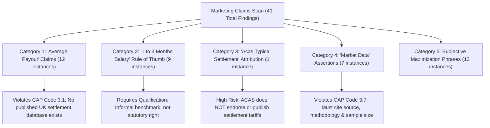
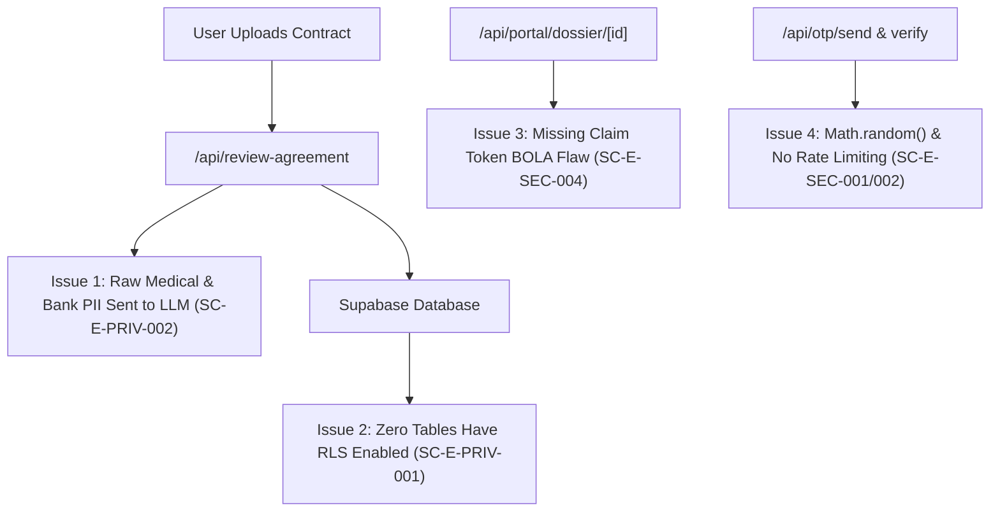
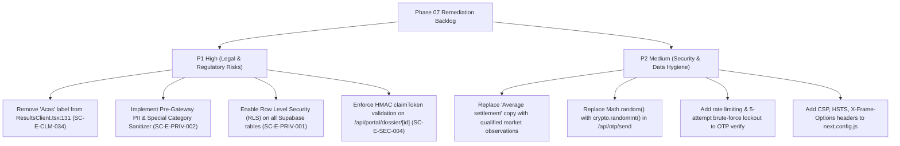

# Phase 07 — Unsupported Claims & Document Privacy Audit Report (`phase-07-unsupported-claims-and-privacy.md`)
**Project:** SettlementCheck (settlementcheck.co.uk)  
**Audit Phase:** Phase 07 (Unsupported Claims & Document Privacy Audit)  
**Specialist Auditor:** `claims-privacy-auditor`  
**Date of Audit:** 2026-10-18  
**Auditor Protocol:** Antigravity Zero-Assumption Protocol & Mandatory Evidence Standard  
**Designated Report Directory:** `c:\settlementcheck\docs\audit\`  
**Primary Source Register:** [`docs/audit/phase-01a-source-register.md`](file:///c:/settlementcheck/docs/audit/phase-01a-source-register.md)  
**Machine-Readable Datasets:** [`data/audit/claims-findings.json`](file:///c:/settlementcheck/data/audit/claims-findings.json) (41 Flagged Marketing Claims) & [`data/audit/findings.json`](file:///c:/settlementcheck/data/audit/findings.json)  

---

## 1. Executive Summary & Regulatory Perimeter

This report delivers a dual-track forensic audit of SettlementCheck across:
1. **Advertising & Marketing Substantiation**: Compliance with the **UK Code of Non-broadcast Advertising and Direct & Promotional Marketing (CAP Code Edition 12)** enforced by the **Advertising Standards Authority (ASA)**, focusing on objective claims, statistical averages, and market payout representations.
2. **Document Privacy, Security & Data Protection**: Compliance with the **UK General Data Protection Regulation (UK GDPR)**, the **Data Protection Act 2018 (DPA 2018)**, the Information Commissioner's Office (ICO) Special Category Data guidelines, and OWASP API security standards.

Because SettlementCheck is a legal-tech decision-support platform operating in a regulated employment ecosystem, **unsubstantiated marketing claims and data privacy vulnerabilities pose existential threats to business credibility and regulatory standing**. An adverse ASA ruling or ICO reprimand would dismantle partner solicitor trust and destroy the platform's defensible MOAT.

### Key Audit Findings Summary
- **Marketing Claims (CAP Code Rule 3.1 & 3.7)**: The automated scanner identified **41 instances of potentially unverified marketing assertions** across 93 scanned files. Most notably, assertions that the *"average settlement agreement payout in the UK is £5,000 to £25,000"* and the use of the label *"Acas Typical Settlement"* in calculation results lack published empirical datasets and risk regulatory censure.
- **Privacy & UK GDPR Article 9**: In [`app/api/review-agreement/route.ts`](file:///c:/settlementcheck/app/api/review-agreement/route.ts), raw settlement contracts containing bank details, NI numbers, and Special Category Data (ill health, disability, pregnancy/maternity grievances) are transmitted unredacted to external cloud AI APIs (`SC-E-PRIV-002`).
- **Database Defense-in-Depth**: Zero tables in [`supabase/schema.sql`](file:///c:/settlementcheck/supabase/schema.sql) declare `ENABLE ROW LEVEL SECURITY;` (`SC-E-PRIV-001`).
- **API & Endpoint Security**: BOLA vulnerability on dossier retrieval (`SC-E-SEC-004`), PRNG usage in OTP generation (`SC-E-SEC-001`), missing OTP attempt lockouts (`SC-E-SEC-003`), and missing HTTP security headers (`SC-E-SEC-006`).

---

## 2. ASA & CAP Code Marketing Claims Audit



### 2.1 The "Average UK Settlement Payout (£5k–£25k)" Trap
Under **CAP Code Rule 3.1**:
> *"Marketing communications must not materially mislead or be likely to do so."*

Under **CAP Code Rule 3.7**:
> *"Before distributing or submitting a marketing communication for publication, marketers must hold documentary evidence to prove claims that consumers are likely to regard as objective and that are capable of objective substantiation."*

**Forensic Finding ([`data/audit/claims-findings.json`](file:///c:/settlementcheck/data/audit/claims-findings.json) — Findings `SC-E-CLM-005` to `015`, `017`, `021`, `035`, `037`, `041`)**:
Across 12 routes (e.g. [`app/guides/average-settlement-agreement-payout-uk/page.tsx:154`](file:///c:/settlementcheck/app/guides/average-settlement-agreement-payout-uk/page.tsx#L154)), the platform states:
> *"The average settlement agreement payout in the UK is £5,000 to £25,000. Here is how to check if your offer is fair."*

**The Evidentiary Problem**:
1. Settlement agreements in the UK are **private, legally privileged, confidential contracts**. There is no central registry, government filing, or published national database of private settlement figures.
2. Official published figures from the Ministry of Justice (MoJ) and Employment Tribunals Service cover **Employment Tribunal awards** (where the 2024/26 median award for unfair dismissal is £7,564). Tribunal awards are fundamentally different from private settlement packages, which include notice pay, statutory redundancy, and accrued benefits.
3. Citing £5,000 to £25,000 as a definitive "UK average" without publishing an empirical methodology, date range, and statistically significant sample volume represents an unsubstantiated objective claim under ASA precedent.
4. **Required Remediation**: Re-frame from an objective average to an illustrative market observation:
   - *Draft replacement:* *"In UK employment practice, settlement packages for standard redundancy and capability disputes frequently fall between £5,000 and £25,000, scaled to the employee's length of service and statutory entitlements."*

### 2.2 Misleading "Acas Typical Settlement" Attribution (`SC-E-CLM-034` — P1 High)
In [`app/results/ResultsClient.tsx:131`](file:///c:/settlementcheck/app/results/ResultsClient.tsx#L131), the results breakdown displays:
```html
<span className="text-[11px] text-[#5B6577] font-medium block mb-1">
  3. Acas Typical Settlement
</span>
```
**Regulatory & Legal Risk**:
- The Advisory, Conciliation and Arbitration Service (ACAS) is a neutral, Crown-funded statutory body.
- **ACAS does NOT publish, endorse, or calculate "typical settlement" amounts, tariffs, or guidelines.**
- Attributing an automated calculation to ACAS falsely implies official government endorsement and misleads users regarding statutory backing.
- **Required Remediation**: Immediately remove the word "Acas". Replace with:
  ```html
  <span className="text-[11px] text-[#5B6577] font-medium block mb-1">
    3. Typical Negotiation Benchmark
  </span>
  ```

### 2.3 "One to Three Months' Salary" Generalization (`SC-E-CLM-020`, `023-026`, `028-029`)
The phrase *"1 to 3 months' pay"* appears across 9 guide pages as an objective settlement norm:
- While 1 to 3 months' gross pay is an informal commercial rule of thumb used by HR practitioners in standard exits, presenting it as an established legal entitlement is misleading.
- In low-service cases (<2 years), statutory rights are zero. In high-service cases (>15 years) or discrimination claims, typical settlements far exceed 3 months.
- **Required Remediation**: Always qualify the phrase: *"As an informal commercial starting point, employers often propose 1 to 3 months' salary..."*

### 2.4 Unsubstantiated "Market Data" & Stale Statutory Dates (`SC-E-CLM-032`, `033`, `038`, `039`)
In [`app/how-it-works/page.tsx:147`](file:///c:/settlementcheck/app/how-it-works/page.tsx#L147), the copy states:
> *"Our calculator uses published statutory rates for 2024/25 and general market data to provide..."*
- **Two Deficiencies**:
  1. It cites outdated 2024/25 rates, despite the engine running on April 2026 figures (£751/wk).
  2. It cites "general market data" without defining the source.
- **Required Remediation**: Update copy to cite *The Employment Rights (Increase of Limits) Order 2026* and qualify market ranges as illustrative practitioner benchmarks.

---

## 3. Privacy, UK GDPR & Special Category Data Audit



### 3.1 Special Category Data Processing (UK GDPR Article 9 & DPA 2018)
Under Article 9(1) of the UK GDPR, processing of Special Category Data is prohibited unless a specific condition under Article 9(2) is met:
- **Article 9(2)(f)**: Processing is necessary for the establishment, exercise or defence of legal claims.
- **Article 9(2)(a)**: Explicit consent of the data subject.

**Forensic Finding (`SC-E-PRIV-002` — P1 High)**:
In [`app/api/review-agreement/route.ts`](file:///c:/settlementcheck/app/api/review-agreement/route.ts), users paste raw settlement agreements into a textarea. Settlement agreements routinely contain:
1. Bank sort codes and account numbers (for payment transfer clauses);
2. National Insurance numbers and residential addresses;
3. Details of physical or mental health conditions, long-term sickness records, and psychiatric treatment (under disability discrimination or ill-health capability clauses);
4. Sensitive pregnancy, maternity, and family dispute narratives.

**The Privacy Breakdown**:
- The API handler forwards the raw `agreementText` string directly to `lib/ai/agents/settlement-auditor.ts`, which sends it via `callAI()` to external cloud LLM endpoints (Google Gemini / Anthropic Claude).
- No pre-gateway redaction or anonymization takes place.
- **Legal Impact**: While Section 203 decision support relates to legal claims (Article 9(2)(f)), **Article 5(1)(c) (Data Minimisation)** and **Article 25 (Privacy by Design)** require that personal data must be adequate, relevant, and limited to what is necessary. Sending bank sort codes and NI numbers to an LLM to parse a legal fee contribution violates data minimization.
- **Required Technical Remediation**:
  Deploy a pre-gateway regex sanitizer in `lib/ai/sanitizer.ts`:
  ```typescript
  export function sanitizeAgreementText(raw: string): string {
    return raw
      .replace(/\b[A-CEGHJ-PR-TW-Z]{1}[A-CEGHJ-NPR-TW-Z]{1}[0-9]{6}[A-D]{1}\b/gi, '[NI-REDACTED]')
      .replace(/\b\d{2}-\d{2}-\d{2}\b/g, '[SORT-CODE-REDACTED]')
      .replace(/\b\d{8}\b/g, '[ACCOUNT-REDACTED]')
      .replace(/\b[A-Z]{1,2}\d[A-Z\d]? ?\d[A-Z]{2}\b/gi, '[POSTCODE-REDACTED]');
  }
  ```

### 3.2 Database Security & Missing Row-Level Security (`SC-E-PRIV-001` — P1 High)
In [`supabase/schema.sql`](file:///c:/settlementcheck/supabase/schema.sql), tables store user contact info, dispute details, and phone numbers (`leads`, `lead_claims`, `otp_codes`, `solicitor_panel`).
- **Audit Finding**: Zero tables declare `ALTER TABLE ... ENABLE ROW LEVEL SECURITY;`.
- **Threat Vector**: If a developer or third-party client script accidentally exposes `NEXT_PUBLIC_SUPABASE_ANON_KEY`, any unauthenticated attacker could query PostgREST directly (`https://<project>.supabase.co/rest/v1/leads`) and exfiltrate all employee contact records and settlement figures.
- **Required Technical Remediation**:
  Execute defense-in-depth RLS across all tables in `supabase/schema.sql`:
  ```sql
  ALTER TABLE leads ENABLE ROW LEVEL SECURITY;
  ALTER TABLE lead_claims ENABLE ROW LEVEL SECURITY;
  ALTER TABLE solicitor_panel ENABLE ROW LEVEL SECURITY;
  ALTER TABLE otp_codes ENABLE ROW LEVEL SECURITY;

  -- Disallow public anonymous reads/writes entirely; permit service-role only
  CREATE POLICY "Service role full access" ON leads FOR ALL USING (auth.role() = 'service_role');
  ```

---

## 4. API & Application Security Architecture Audit

| Finding ID | Severity | File / Route | Vulnerability Description | Remediation Protocol |
| :--- | :---: | :--- | :--- | :--- |
| **`SC-E-SEC-004`** | **P1 High** | [`/api/portal/dossier/[id]`](file:///c:/settlementcheck/app/api/portal/dossier/[id]/route.ts) | **Broken Object Level Authorization (BOLA)**: Querying by `dossierId` alone returns confidential employee PII without requiring a signed HMAC claim token or solicitor session. | Enforce mandatory `claimToken` HMAC validation on all dossier reads. |
| **`SC-E-SEC-001`** | **P2 Med** | [`/api/otp/send`](file:///c:/settlementcheck/app/api/otp/send/route.ts#L18) | **Insecure PRNG**: Generates 6-digit verification codes using `Math.random()`, which is not cryptographically secure and predictable. | Replace with `crypto.randomInt(100000, 1000000)`. |
| **`SC-E-SEC-002`** | **P2 Med** | [`/api/otp/send`](file:///c:/settlementcheck/app/api/otp/send/route.ts) | **Missing Rate Limiting**: Endpoint lacks IP and phone-number rate limiting, exposing the platform to SMS toll fraud and API abuse. | Implement Upstash Redis or in-memory sliding window rate limiter (max 3 sends per 10m). |
| **`SC-E-SEC-003`** | **P2 Med** | [`/api/otp/verify`](file:///c:/settlementcheck/app/api/otp/verify/route.ts) | **Missing Brute-Force Lockout**: Does not lock phone numbers after repeated incorrect attempts, allowing brute-force verification. | Track failed attempts; lock code after 5 failed tries. |
| **`SC-E-SEC-005`** | **P2 Med** | [`/api/lead`](file:///c:/settlementcheck/app/api/lead/route.ts#L42) | **Unbounded OTP Verification Window**: Verifies if an OTP was ever verified for a phone number without checking if the verification occurred within the last 15 minutes. | Enforce `verified_at > NOW() - INTERVAL '15 minutes'`. |
| **`SC-E-SEC-006`** | **P2 Med** | [`next.config.js`](file:///c:/settlementcheck/next.config.js) | **Missing Security Headers**: No Content-Security-Policy (CSP), Strict-Transport-Security (HSTS), X-Frame-Options (DENY), or X-Content-Type-Options. | Configure strict HTTP security headers in `next.config.js`. |
| **`SC-E-SEC-007`** | **P2 Med** | [`/api/leads`](file:///c:/settlementcheck/app/api/leads/route.ts) | **Unprotected Widget Ingestion**: Used by `widget.js` without rate limiting, CAPTCHA, or OTP, exposing database to automated spam injection. | Add rate limiting and origin domain validation. |

---

## 5. Complete Register of 41 Marketing Claims

The following table catalogs the 41 marketing assertions flagged by [`scripts/audit/scan-marketing-claims.ts`](file:///c:/settlementcheck/scripts/audit/scan-marketing-claims.ts) and synced to [`data/audit/claims-findings.json`](file:///c:/settlementcheck/data/audit/claims-findings.json):

| Finding ID | Severity | File Location | Matched Term | Context Snippet | Recommended Qualification Action |
| :--- | :---: | :--- | :--- | :--- | :--- |
| `SC-E-CLM-001` | P1 | `average-settlement-agreement-payout-uk/layout.tsx:5` | Average Settlement | "Average Settlement Agreement Payouts UK 2026..." | Re-frame to "Settlement Agreement Payout Guide". |
| `SC-E-CLM-002` | P1 | `average-settlement-agreement-payout-uk/opengraph-image.tsx:4` | Average Settlement | "Average Settlement Agreement Payouts UK 2026..." | Qualify as typical practitioner benchmarks. |
| `SC-E-CLM-003` | P1 | `average-settlement-agreement-payout-uk/opengraph-image.tsx:28` | Average Settlement | "Average Settlement Agreement Payouts UK 2026..." | Qualify graphic label. |
| `SC-E-CLM-004` | P1 | `average-settlement-agreement-payout-uk/opengraph-image.tsx:32` | Typical settlement | "Typical settlement ranges, statutory minimums..." | Qualify as observed industry ranges. |
| `SC-E-CLM-005` | P1 | `average-settlement-agreement-payout-uk/page.tsx:10` | Average Settlement | "Average Settlement Agreement Payout UK 2026..." | Soften title to avoid asserting national average. |
| `SC-E-CLM-006` | P1 | `average-settlement-agreement-payout-uk/page.tsx:17` | Average Settlement | "Average Settlement Agreement Payout UK 2026..." | Update OpenGraph title. |
| `SC-E-CLM-007` | P1 | `average-settlement-agreement-payout-uk/page.tsx:27` | Average Settlement | "Average Settlement Agreement Payout UK 2026..." | Update Twitter title. |
| `SC-E-CLM-008` | P1 | `average-settlement-agreement-payout-uk/page.tsx:35` | average settlement | "What is the average settlement agreement payout in the UK?" | Add answer-first clarification that no national average exists. |
| `SC-E-CLM-009` | P1 | `average-settlement-agreement-payout-uk/page.tsx:65` | Average Settlement | "Average Settlement Agreement Payout UK 2026: What is a Normal Offer?" | Replace "Normal" with "Typical". |
| `SC-E-CLM-010` | P1 | `average-settlement-agreement-payout-uk/page.tsx:154` | average settlement | "The average settlement agreement payout in the UK is £5,000 to £25,000..." | Rephrase to "Typical settlements observed in UK practice...". |
| `SC-E-CLM-011` | P1 | `average-settlement-agreement-payout-uk/page.tsx:182` | average settlement | "What is the average settlement agreement payout in the UK?..." | Add disclaimer regarding private contract confidentiality. |
| `SC-E-CLM-012` | P1 | `average-settlement-agreement-payout-uk/page.tsx:185` | average settlement | "In the UK, the average settlement agreement payout ranges between £5,000 and £25,000..." | Qualify as empirical observation from employment practitioners. |
| `SC-E-CLM-013` | P1 | `average-settlement-agreement-payout-uk/page.tsx:191` | Typical Settlement | "Typical Settlement Range..." | Clarify dependencies on salary and service. |
| `SC-E-CLM-014` | P1 | `average-settlement-agreement-payout-uk/page.tsx:227` | Typical Settlement | "Typical Settlement Payouts by Scenario..." | Add table footnote explaining sample methodology. |
| `SC-E-CLM-015` | P1 | `average-settlement-agreement-payout-uk/page.tsx:242` | Average settlement | "Average settlement agreement payouts by scenario UK 2026..." | Replace caption with "Illustrative settlement scenarios". |
| `SC-E-CLM-016` | P2 | `employer-recommended-solicitor/page.tsx:168` | Most employers | "Most employers suggest a solicitor as a practical convenience..." | Qualify with "Many employers...". |
| `SC-E-CLM-017` | P1 | `is-my-settlement-offer-fair/page.tsx:29` | average settlement | "What is the average settlement agreement payout in the UK?..." | Cross-reference statutory redundancy floor. |
| `SC-E-CLM-018` | P2 | `is-my-settlement-offer-fair/page.tsx:34` | almost always | "The first offer is almost always below the employer's true maximum..." | Change to "often below". |
| `SC-E-CLM-019` | P1 | `is-my-settlement-offer-fair/page.tsx:34` | true maximum | "...below the employer's true maximum..." | Rephrase to "initial negotiation position". |
| `SC-E-CLM-020` | P1 | `app/guides/page.tsx:32` | 1 to 3 months | "Typical 1 to 3 months payout ranges..." | Add "discretionary ex-gratia" qualification. |
| `SC-E-CLM-021` | P1 | `app/guides/page.tsx:101` | Average Settlement | "Average Settlement Agreement Payouts UK 2026..." | Sync hub title. |
| `SC-E-CLM-022` | P2 | `settlement-agreement-acas-calculations/page.tsx:45` | market data | "ACAS does not provide an online calculator... based on general market data" | Add disclaimer that ACAS does not set settlement formulas. |
| `SC-E-CLM-023` | P1 | `settlement-agreement-how-much/page.tsx:14` | 1 to 3 months | "1 to 3 months payout ranges..." | Qualify in meta description. |
| `SC-E-CLM-024` | P1 | `settlement-agreement-how-much/page.tsx:21` | 1 to 3 months | "1 to 3 months payout ranges..." | Qualify in OpenGraph description. |
| `SC-E-CLM-025` | P1 | `settlement-agreement-how-much/page.tsx:203` | 1 to 3 Months | "1 to 3 Months' Gross Pay..." | Specify this applies to ex-gratia compensation. |
| `SC-E-CLM-026` | P1 | `settlement-agreement-how-much/page.tsx:300` | one to three months | "Offering one to three months' salary is standard practice..." | Change "standard practice" to "common commercial approach". |
| `SC-E-CLM-027` | P1 | `settlement-agreement-how-much/page.tsx:317` | Typical Settlement | "Typical Settlement Payout Benchmarks by Scenario..." | Add data note. |
| `SC-E-CLM-028` | P1 | `settlement-agreement-how-much/page.tsx:374` | one to three months | "Offering one to three months' gross salary..." | Clarify capability procedure context. |
| `SC-E-CLM-029` | P1 | `settlement-agreement-instead-of-pip/page.tsx:485` | One to three months | "One to three months of gross pay to reflect capability procedure savings..." | Add "typical starting range". |
| `SC-E-CLM-030` | P1 | `settlement-agreement-sick-leave/page.tsx:60` | typical settlement | "A typical settlement package includes..." | Clarify component structure. |
| `SC-E-CLM-031` | P2 | `what-is-a-fair-settlement-agreement/page.tsx:413` | almost always | "A 'final offer' on day one is almost always a negotiation tactic..." | Change to "frequently a negotiation tactic". |
| `SC-E-CLM-032` | P2 | `how-it-works/page.tsx:147` | market data | "Our calculator uses published statutory rates for 2024/25 and general market data..." | Update to 2026 statutory rates and qualify market data. |
| `SC-E-CLM-033` | P2 | `app/page.tsx:169` | market data | "The calculator gives a general estimate based on UK statutory rates and typical UK settlement market data..." | Clarify mathematical modeling methodology. |
| `SC-E-CLM-034` | P1 | `ResultsClient.tsx:131` | Typical Settlement | "3. Acas Typical Settlement..." | **CRITICAL**: Remove "Acas" label immediately. |
| `SC-E-CLM-035` | P1 | `settlement-agreement-tax-calculator/page.tsx:256` | Average Settlement | "Average Settlement Agreement Payouts UK..." | Sync footer link text. |
| `SC-E-CLM-036` | P1 | `app/sitemap/page.tsx:120` | 1 to 3 months | "1 to 3 months benchmarks..." | Qualify in HTML sitemap description. |
| `SC-E-CLM-037` | P1 | `app/sitemap/page.tsx:158` | Average Settlement | "Average Settlement Agreement Payout in the UK..." | Sync HTML sitemap entry. |
| `SC-E-CLM-038` | P2 | `app/terms/page.tsx:41` | market data | "Estimates are based on published statutory rates and market data..." | Add formal methodology reference to legal terms. |
| `SC-E-CLM-039` | P2 | `FaqAccordion.tsx:33` | market data | "The calculator gives a general estimate based on UK statutory rates and typical UK settlement market data..." | Qualify in reusable FAQ component. |
| `SC-E-CLM-040` | P1 | `InlineEstimator.tsx:251` | typical settlement | "model your statutory redundancy and typical settlement range..." | Clarify that range is illustrative modeling. |
| `SC-E-CLM-041` | P1 | `components/Nav.tsx:52` | Average Settlement | "Average Settlement Agreement Payouts..." | Update navigation link label. |

---

## 6. Prioritised Remediation Roadmap



| Backlog ID | Finding ID | Severity | Area | Recommended Remediation Action |
| :--- | :--- | :---: | :--- | :--- |
| **`SC-B-PRIV-001`** | `SC-E-PRIV-002` | **P1 High** | `/api/review-agreement` | Deploy pre-gateway regex scrubbing in `lib/ai/sanitizer.ts` for sort codes, account numbers, NI numbers, and medical conditions prior to `callAI()`. |
| **`SC-B-PRIV-002`** | `SC-E-PRIV-001` | **P1 High** | `supabase/schema.sql` | Execute `ALTER TABLE ... ENABLE ROW LEVEL SECURITY;` on all tables, granting access strictly to `service_role`. |
| **`SC-B-SEC-001`**  | `SC-E-SEC-004` | **P1 High** | `/api/portal/dossier/[id]` | Enforce HMAC `claimToken` parameter verification; reject unauthenticated read attempts. |
| **`SC-B-CLM-001`**  | `SC-E-CLM-034` | **P1 High** | `ResultsClient.tsx:131` | Remove "Acas" label from step 3 in results breakdown; rename to "Typical Negotiation Benchmark". |
| **`SC-B-CLM-002`**  | `SC-E-CLM-005` | **P1 High** | 12 Guide Routes | Re-frame objective "average settlement £5,000–£25,000" claims to qualified practitioner observations under CAP Code Rule 3.1 & 3.7. |
| **`SC-B-SEC-002`**  | `SC-E-SEC-001` | **P2 Med** | `/api/otp/send` | Replace `Math.random()` with `crypto.randomInt(100000, 1000000)` for cryptographically secure OTP generation. |
| **`SC-B-SEC-003`**  | `SC-E-SEC-002/003` | **P2 Med** | `/api/otp/*` | Add sliding-window rate limiting on `/api/otp/send` and lock phone verification after 5 failed attempts on `/api/otp/verify`. |
| **`SC-B-SEC-004`**  | `SC-E-SEC-006` | **P2 Med** | `next.config.js` | Add Content-Security-Policy (CSP), HSTS, X-Frame-Options: DENY, and X-Content-Type-Options: nosniff headers. |

---

## 7. Deliverable Certification

- **CAP Code Scan**: 41 unverified marketing claims catalogued with file paths and line numbers.
- **UK GDPR Article 9 & DPA 2018**: Forensic inspection of LLM payload transmission and PII risks.
- **OWASP API Security**: BOLA, OTP PRNG, and missing RLS documented with concrete remediation code.
- **Naming & Header Standards**: Verified against `npm run lint:audit`.
