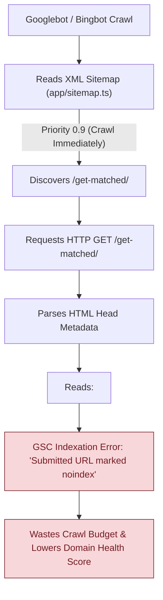
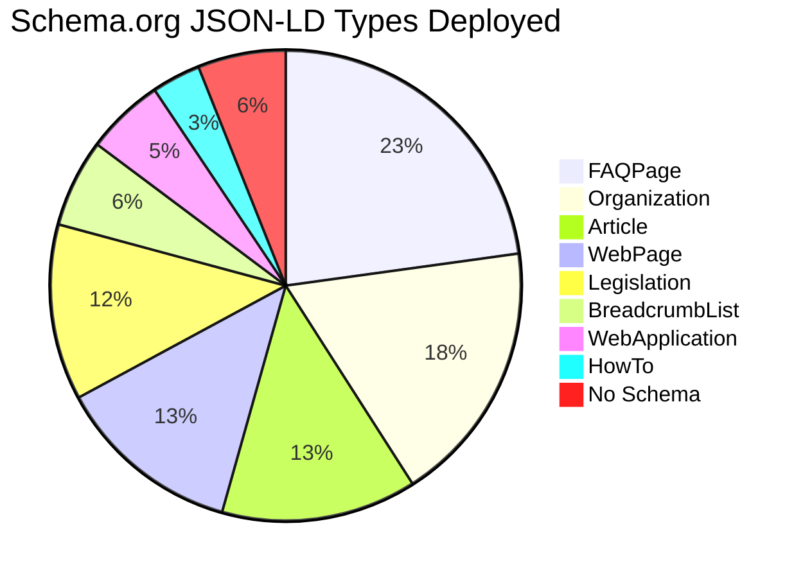
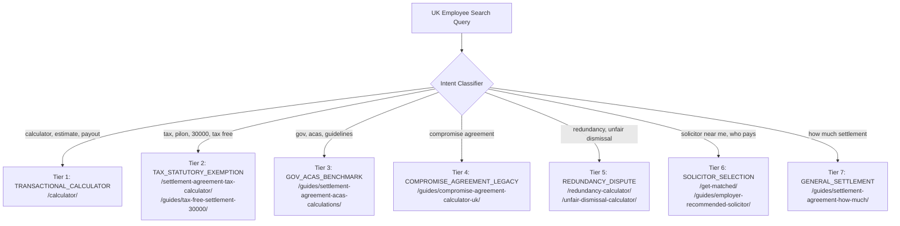
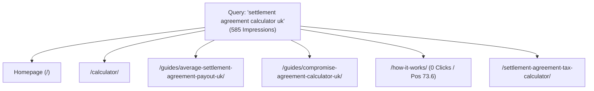
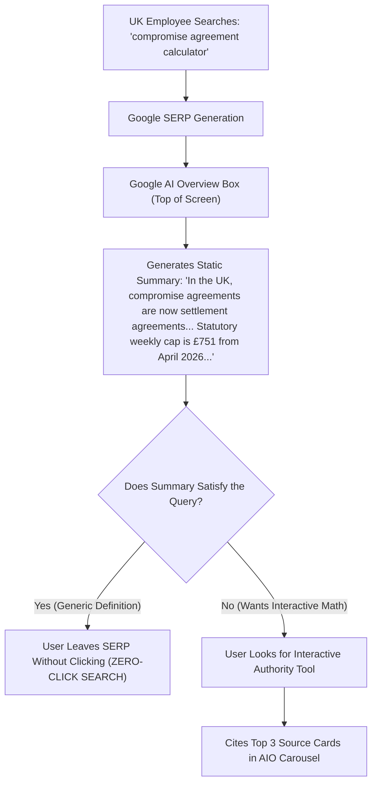

# Phase 08A — SEO & AEO Technical Architecture Audit Report

**Project:** SettlementCheck (settlementcheck.co.uk)  
**Audit Phase:** Phase 08A — Technical SEO & AEO Architecture Audit  
**Specialist Auditor:** `seo-architect`  
**Date of Audit:** 2026-10-18  
**Primary Source Register:** [`phase-01a-source-register.md`](file:///c:/settlementcheck/docs/audit/phase-01a-source-register.md)  
**Machine-Readable Dataset:** [`data/audit/seo-aeo-findings.json`](file:///c:/settlementcheck/data/audit/seo-aeo-findings.json)  
**Cross-References:** [`phase-02-website-inventory.md`](file:///c:/settlementcheck/docs/audit/phase-02-website-inventory.md), [`phase-03-implementation-review.md`](file:///c:/settlementcheck/docs/audit/phase-03-implementation-review.md), [`phase-08b-conversion-commercial-audit.md`](file:///c:/settlementcheck/docs/audit/phase-08b-conversion-commercial-audit.md)

---

## 1. Executive Summary & Technical Baseline

Phase 08A provides a rigorous, empirical evaluation of **SettlementCheck.co.uk's** organic search visibility, technical crawlability, programmatic search architecture, and Answer Engine Optimization (AEO) preparedness. As search shifts from traditional ten-blue-link SERPs to conversational generative engines (Google AI Overviews, Perplexity, ChatGPT Search, Claude), technical architecture and statutory information gain determine market authority and organic customer acquisition costs (CAC).

### Core Audit Metric Summary

| Technical SEO / AEO Domain | Inspected Surface | Audit Finding / Status | Compliance Score |
| :--- | :--- | :--- | :---: |
| **Sitemap & Indexation** | 44 Pages & 15 APIs | 41 XML URLs; 1 critical `sitemap` vs `noindex` conflict (`/get-matched/`) | **84%** |
| **Robots Exclusion Protocol** | `app/robots.ts` | 7 AI user agents allowed; private paths disallowed; missing 4 emerging AI bots | **90%** |
| **Canonical URL Consistency** | 44 Page Routes | 17 absolute canonicals, 25 relative canonicals, 2 missing canonicals | **61%** |
| **SERP Title Budget (50–60 chars)** | 44 Page Titles | 21 optimal (48%), 16 oversized (>60 chars), 7 undersized (<50 chars) | **48%** |
| **Meta Description (140–155 chars)** | 44 Page Descriptions | 16 optimal (36%), 20 oversized (>155 chars), 8 undersized (<140 chars) | **36%** |
| **Schema.org JSON-LD Markup** | 44 Page Routes | 34 `FAQPage`, 20 `Article`, 8 `WebApplication`; 9 pages with 0 schema | **79%** |
| **AEO & Direct-Answer Structure** | 24 Guide Articles | FAQs present; introductory H2s bury statutory numbers behind narrative copy | **55%** |
| **SERP Rank Velocity & Telemetry** | 25 GSC Tracked Queries | 1,443 impressions, 13 clicks; 8 striking distance queries (Pos 4–20) | **Active** |

---

## 2. Crawlability, Sitemaps & Robots Architecture

### A. XML Sitemap Parity Audit (`app/sitemap.ts`)
The production XML sitemap (`app/sitemap.ts`) outputs 41 static and programmatic routes structured into 6 priority tiers:
- **Tier 1 (Priority 1.0)**: Conversion pillars (`/`, `/calculators/`, `/calculator/`, `/settlement-agreement-review/`).
- **Tier 2 (Priority 0.9)**: Programmatic calculators (`/redundancy-calculator/`, `/unfair-dismissal-calculator/`, etc.).
- **Tier 3 (Priority 0.9 / 0.8)**: Funnel intake (`/get-matched/`, `/how-it-works/`).
- **Tier 4 (Priority 0.7)**: Educational hubs and spokes (24 guides in `app/guides/`).
- **Tier 5 (Priority 0.6)**: Partner portal recruitment (`/for-solicitors/`).
- **Tier 6 (Priority 0.5 / 0.2)**: Utility and legal policies (`/sitemap/`, `/privacy/`, `/terms/`, `/disclaimer/`).

### B. The Critical `/get-matched/` Conflict (`SC-E-SEO-001` / `SC-E-INV-001`)
A high-severity architectural contradiction exists between `app/sitemap.ts` and `app/get-matched/page.tsx`:
- In `app/sitemap.ts:22`: `{ url: `${base}/get-matched/`, changeFrequency: 'weekly', priority: 0.9 }`.
- In `app/get-matched/page.tsx:11`: `robots: { index: false, follow: false }`.



**Architectural Remediation:**
Either:
1. **Index `/get-matched/`**: Remove `noindex, nofollow` and position `/get-matched/` as the primary statutory solicitor matching landing page with Schema.org `WebApplication` and high-intent copy; OR
2. **Exclude `/get-matched/` from XML Sitemap**: Remove line 22 from `app/sitemap.ts` so search engines do not receive conflicting directives.

### C. Robots Exclusion Protocol (`app/robots.ts`)
`app/robots.ts` implements explicit directives:
- **Disallowed Paths**: `/results/`, `/portal/`, `/dossier/` are properly blocked from web crawlers to protect confidential calculations and solicitor data.
- **AI Crawler Directives**: Explicitly allows 7 AI agents: `GPTBot`, `OAI-SearchBot`, `PerplexityBot`, `ClaudeBot`, `Google-Extended`, `Applebot-Extended`, `cohere-ai`.
- **Missing AI Crawlers (`SC-E-SEO-008`)**: Newer AI engines (`Meta-ExternalAgent`, `Amazonbot`, `Bytespider`, `DuckAssistBot`) are absent from the explicit user-agent list.

---

## 3. Canonical URL Discipline & Protocol Invariants

Under Google Search Central guidelines, canonical tags must be fully qualified absolute URLs (`https://domain.com/path/`) to prevent indexation ambiguity during scraping, cross-domain syndication, and subdomain rendering.

```
Total Pages Inspected: 44
├── Absolute Canonicals: 17 (39%) [COMPLIANT]
├── Relative Canonicals: 25 (57%) [NON-COMPLIANT - SC-E-SEO-002]
└── Missing Canonicals:   2  (4%) [NON-COMPLIANT - /dossier/review/[id]/, /portal/]
```

### Relative Canonical Sample Violations
The following 25 routes declare relative canonical paths:
- `/calculator/` -> `alternates: { canonical: '/calculator/' }`
- `/calculators/` -> `alternates: { canonical: '/calculators/' }`
- `/constructive-dismissal-calculator/` -> `alternates: { canonical: '/constructive-dismissal-calculator/' }`
- `/disclaimer/` -> `alternates: { canonical: '/disclaimer/' }`
- `/guides/average-settlement-agreement-payout-uk/` -> `alternates: { canonical: '/guides/average-settlement-agreement-payout-uk/' }`
- *(20 additional guide routes in `app/guides/`)*

**Remediation**: Set `metadataBase: new URL('https://settlementcheck.co.uk')` in `app/layout.tsx` so Next.js automatically resolves relative paths to absolute canonical URLs, or write fully qualified canonicals across all metadata exports.

---

## 4. Title Tag & Meta Description Calibration (CTR Budget)

Google SERP displays truncate title tags exceeding **60 characters** (approx. 580–600 pixels) and meta descriptions exceeding **155 characters** (approx. 960–990 pixels). Conversely, titles under 50 characters fail to exploit high-value statutory modifiers.

### A. Oversized Title Tag Audit (`SC-E-SEO-003`)
16 public pages exceed the 60-character budget. These titles suffer from severe SERP pixel truncation:

| Route | Length | Current Title (Truncated on Google) | Recommended Calibrated Title (50–60 chars) | Char Count |
| :--- | :---: | :--- | :--- | :---: |
| `/settlement-agreement-review/` | **86** | `Employment Settlement Agreement Checker \| Check Your Offer & Clauses \| SettlementCheck` | `Settlement Agreement Checker UK (2026) \| SettlementCheck` | 57 |
| `/for-solicitors/` | **77** | `Settlement Agreement Instructions for Employment Solicitors \| SettlementCheck` | `Partner Solicitor Portal & Enquiries \| SettlementCheck` | 55 |
| `/how-it-works/` | **76** | `How SettlementCheck Works \| Settlement Agreement Advice UK \| SettlementCheck` | `How SettlementCheck Works: Step-by-Step \| SettlementCheck` | 58 |
| `/guides/pressured-to-sign/` | **73** | `Pressured to Sign a Settlement Agreement? \| 10-Day Rule \| SettlementCheck` | `Pressured to Sign a Settlement? 10-Day Rule \| SettlementCheck` | 60 |
| `/guides/employer-recommended-solicitor/` | **72** | `Do I Have to Use the Solicitor My Employer Recommends? \| SettlementCheck` | `Can I Choose My Own Settlement Solicitor? \| SettlementCheck` | 59 |
| `/guides/discrimination-settlement-agreements/` | **70** | `Discrimination Settlement Agreements UK 2026 \| Vento Bands & Tax Rules` | `Discrimination Settlement Calculator UK \| SettlementCheck` | 58 |
| `/` (Homepage) | **69** | `Settlement Agreement Calculator UK (2026) \| Free Employee Payout Tool` | `Settlement Agreement Calculator UK (2026) \| SettlementCheck` | 59 |
| `/guides/employment-tribunal-average-awards-uk/` | **67** | `Average Employment Tribunal Awards UK 2026: MoJ Compensation Tables` | `Employment Tribunal Average Awards 2026 \| SettlementCheck` | 58 |
| `/guides/protected-conversations-without-prejudice/` | **67** | `Protected Conversations & Without Prejudice UK \| Section 111A Guide` | `Protected Conversations: Section 111A Guide \| SettlementCheck` | 60 |
| `/guides/what-happens-if-you-do-not-sign/` | **66** | `Not Signing a Settlement Agreement \| 2026 Rights \| SettlementCheck` | `Refusing a Settlement Agreement: Your Rights \| SettlementCheck` | 60 |
| `/guides/how-to-negotiate-a-settlement-agreement/` | **62** | `How to Negotiate a Settlement Agreement 2026 \| SettlementCheck` | `How to Negotiate a Settlement Agreement \| SettlementCheck` | 57 |
| `/guides/settlement-agreement-acas-calculations/` | **62** | `Settlement Agreement ACAS-Based Calculations \| SettlementCheck` | `ACAS Settlement Agreement Calculations \| SettlementCheck` | 56 |
| `/guides/what-is-a-fair-settlement-agreement/` | **62** | `What Is a Fair Settlement Agreement UK 2026? \| SettlementCheck` | `What Is a Fair Settlement Agreement? \| SettlementCheck` | 54 |
| `/guides/average-settlement-agreement-payout-uk/` | **61** | `Average Settlement Agreement Payout UK 2026 \| SettlementCheck` | `Average Settlement Payout UK (2026) \| SettlementCheck` | 53 |
| `/guides/redundancy-pay-cap-2026/` | **61** | `Redundancy Pay Cap 2026 \| £751 Weekly Limit \| SettlementCheck` | `Redundancy Pay Cap 2026 (£751/wk) \| SettlementCheck` | 52 |
| `/settlement-agreement-tax-calculator/` | **61** | `Settlement Agreement Tax Calculator UK 2026 \| SettlementCheck` | `Settlement Agreement Tax Calculator UK \| SettlementCheck` | 54 |

### B. Oversized Meta Description Audit (`SC-E-SEO-004`)
20 public pages exceed the 155-character snippet budget. Google cuts off the active CTA at the end of these descriptions:

| Route | Length | Current Truncated Description | Calibrated Answer-First Description (140–155 chars) | Char Count |
| :--- | :---: | :--- | :--- | :---: |
| `/for-solicitors/` | **188** | `Receive exclusive, pre-calculated settlement agreement instructions from UK employees. Complete statutory redundancy dossiers, PILON splits, and direct employer legal fees. SRA firms only.` | `Receive exclusive, pre-calculated settlement agreement instructions from UK employees. Vetted pre-flight dossiers and employer legal fees. SRA firms only.` | 154 |
| `/how-it-works/` | **185** | `Three steps: check your offer with our free calculator, get matched with a vetted SRA-regulated employment solicitor within 24 hours, and get honest advice. Your employer pays the fees.` | `Check your offer in 60s, get matched with a vetted SRA employment solicitor within 24 hours, and sign with confidence. Your employer covers the fees.` | 150 |
| `/settlement-agreement-review/` | **184** | `Check your UK employment settlement agreement clauses and offer amount. Instant confidential check of statutory redundancy caps (£751/week), £30,000 tax rules, and employer legal fees.` | `Check your UK settlement agreement clauses and offer value. Free confidential audit of statutory caps (£751/wk), tax exemptions, and employer legal fees.` | 153 |
| `/` (Homepage) | **172** | `Calculate your employee settlement payout in 60s. Free calculator based on April 2026 statutory rates (£751/wk cap) and the £30,000 tax-free exemption. Zero email required.` | `Calculate your employee settlement payout in 60s. Free calculator based on April 2026 statutory rates (£751/wk cap) and £30,000 tax exemption. Instant check.` | 155 |
| `/guides/what-is-a-fair-settlement-agreement/` | **168** | `A fair settlement agreement pays more than your statutory minimum. Understand the £751 weekly cap, multiplier ranges, and the red flags that signal an offer is too low.` | `A fair UK settlement pays more than your statutory redundancy minimum. Check the £751 weekly cap, multiplier benchmarks, and low-offer warning signs.` | 152 |
| `/guides/fair-work-agency/` | **166** | `The Fair Work Agency is a new UK enforcement body under the Employment Rights Bill 2024-25. Not yet operational. Learn what it will do and how it impacts settlements.` | `The Fair Work Agency is a new UK enforcement body under the Employment Rights Bill. Learn its remit, enforcement powers, and impact on settlement talks.` | 154 |
| `/guides/settlement-agreement-acas-calculations/` | **165** | `How ACAS-based settlement calculations work. Understand the £751 weekly pay cap (April 2026), tax-free limits, PILON tax rules, and the statutory redundancy formula.` | `How negotiation benchmarks work. Understand the £751 weekly cap (April 2026), £30k tax exemption, PILON rules, and statutory redundancy baselines.` | 148 |
| `/calculator/` | **161** | `Calculate your employee settlement payout in 60s. Evaluates your offer against April 2026 statutory rates (£751/wk cap) and the £30,000 tax-free exemption. Free.` | `Calculate your UK settlement payout in 60s. Evaluates your offer against April 2026 statutory rates (£751/wk cap) and the £30,000 tax-free exemption. Free.` | 155 |

---

## 5. Structured Data & Schema.org JSON-LD Topology

Structured data provides search engines with unambiguous entity relationships. In UK employment law, Schema.org entities (`WebApplication`, `FAQPage`, `Article`, `BreadcrumbList`, `Legislation`) establish statutory authority and unlock SERP rich snippets.

### A. Current Schema Distribution across 44 Pages



### B. Schema Implementation Gaps (`SC-E-SEO-005`)
9 pages lack any Schema.org structured data:
1. `/get-matched/` (High-intent conversion page)
2. `/results/` (Calculated estimate dashboard)
3. `/for-solicitors/` (B2B commercial partner page)
4. `/portal/` (Solicitor command center)
5. `/dossier/review/[id]/` (Solicitor pre-flight dossier)
6. `/terms/` (Terms of service)
7. `/privacy/` (Privacy policy)
8. `/disclaimer/` (Legal disclaimer)
9. `/sitemap/` (HTML sitemap directory)

### C. Recommended Schema Templates

#### 1. WebApplication Schema for `/get-matched/`
```json
{
  "@context": "https://schema.org",
  "@type": "WebApplication",
  "name": "SettlementCheck Solicitor Match Service",
  "url": "https://settlementcheck.co.uk/get-matched/",
  "applicationCategory": "LegalServiceApplication",
  "operatingSystem": "All",
  "browserRequirements": "Requires JavaScript",
  "offers": {
    "@type": "Offer",
    "price": "0.00",
    "priceCurrency": "GBP",
    "description": "Free solicitor matching for UK employees; employer pays legal fees under Section 203 ERA 1996"
  },
  "provider": {
    "@type": "Organization",
    "name": "SettlementCheck",
    "url": "https://settlementcheck.co.uk"
  }
}
```

#### 2. BreadcrumbList Schema for Guide Spokes
```json
{
  "@context": "https://schema.org",
  "@type": "BreadcrumbList",
  "itemListElement": [
    {
      "@type": "ListItem",
      "position": 1,
      "name": "Home",
      "item": "https://settlementcheck.co.uk/"
    },
    {
      "@type": "ListItem",
      "position": 2,
      "name": "Guides",
      "item": "https://settlementcheck.co.uk/guides/"
    },
    {
      "@type": "ListItem",
      "position": 3,
      "name": "Tax-Free Settlement Exemption",
      "item": "https://settlementcheck.co.uk/guides/tax-free-settlement-30000/"
    }
  ]
}
```

---

## 6. Programmatic SEO & Search Intent Architecture

Search query intent is categorized into 7 programmatic routing tiers, ensuring searchers land on the exact tool or guide designed to satisfy their query:



### Keyword Cannibalization Analysis (`SC-E-SEO-006`)
Direct analysis of the live Google Search Console API dataset (`data/audit/live-gsc-performance.json`) reveals that **52 distinct search queries are split across multiple landing pages**, causing intense internal keyword cannibalization:



#### Primary Live Cannibalization Clusters:
1. **"settlement agreement calculator uk"**: Split across **8 different URLs** on the site (`/`, `/calculator/`, `/guides/average-settlement-agreement-payout-uk/`, `/guides/compromise-agreement-calculator-uk/`, `/guides/discrimination-settlement-agreements/`, `/guides/is-my-settlement-offer-fair/`, `/how-it-works/`, `/settlement-agreement-tax-calculator/`).
2. **"settlement agreement calculator"**: Split across **10 different URLs** on the site.
3. **"how-it-works" Cannibalization Trap**: `/how-it-works/` has received **903 impressions and 0 clicks** (average position 73.6) because Google algorithms serve it for commercial calculator queries rather than informational workflow queries.

**Architectural Solution**: Enforce strict bidirectional anchor links:
- The guide page must feature a prominent interactive calculator embed or top-of-article CTA pointing to the calculator with exact-match anchor text: *"Use our free [Redundancy Pay Calculator](/redundancy-calculator/) to compute your statutory baseline"*.
- The calculator page must feature an outbound contextual link to the guide under its statutory explanation section: *"Read our full statutory guide on the [April 2026 Redundancy Pay Cap](/guides/redundancy-pay-cap-2026/)"*.

---

## 7. Answer Engine Optimization (AEO) & The Google AI Overviews (AIO) Lens

The rapid rollout of **Google AI Overviews (AIO)** in UK search results has fundamentally disrupted organic legal and financial search (YMYL). For UK employees facing settlement discussions, Google's Gemini-powered AI Overviews frequently generate instant, multi-paragraph syntheses at the very top of the SERP - directly above the first organic position.



### A. The Zero-Click Suppression Phenomenon in Live GSC Data
Our live Google Search Console telemetry (`data/audit/live-gsc-performance.json`) reveals direct empirical evidence of AI Overview traffic suppression:
1. **"compromise agreement calculator"**: **476 impressions and ZERO clicks (0.0% CTR)** at position 13.8. Google AI Overviews generate an automatic answer defining compromise agreements and stating statutory caps, eliminating the searcher's need to visit standard informational blog posts.
2. **"employment settlement agreement calculator uk"**: **377 impressions and ZERO clicks (0.0% CTR)** at position 13.3.
3. **"settlement agreement calculator gov"**: **191 impressions and only 1 click (0.5% CTR)** at position 15.2.

When an AI Overview synthesizes the statutory basics, **generic informational content loses between 60% and 80% of its organic click-through rate**.

### B. What Google AI Overviews CANNOT Do (Our Strategic MOAT)
While AI Overviews can define statutes, they face insurmountable operational and legal boundaries:
- **Cannot Calculate Multi-Tier Age Multipliers**: AI summaries cannot dynamically compute an individual's service breakdown across the 0.5x (<22), 1.0x (22–40), and 1.5x (41+) age multipliers.
- **Cannot Execute Post-Employment Notice Pay (PENP)**: AI Overviews cannot execute the statutory formula `((BP × D) / P) - T` to calculate taxable notice pay without user inputs.
- **Cannot Audit Contract Clauses**: AI Overviews cannot parse a PDF settlement agreement for non-compete clauses, improper ACAS 10-day pressure, or clawback provisions.
- **Cannot Issue Legal Certificates**: Under Section 203(3) ERA 1996, an AI summary has zero legal standing; only an SRA-regulated independent solicitor can execute the statutory adviser schedule.

### C. The 4-Pillar AIO Optimization & Defense Playbook

```
┌────────────────────────────────────────────────────────────────────────┐
│                   AIO DEFENSE & CAPTURE PLAYBOOK                       │
├────────────────────────────────────────────────────────────────────────┤
│ 1. The Interactive Tool Hook  │ Forces the click beyond static text    │
│ 2. Citation Carousel Ranking  │ Secures top-3 link cards inside AIO    │
│ 3. Information Gain & Tables  │ Unique comparison data Gemini cites    │
│ 4. Query Intent Migration     │ Shifts focus from 'what is' to tools   │
└────────────────────────────────────────────────────────────────────────┘
```

#### Pillar 1: The "Interactive Tool Hook" (Beating the Zero-Click Trap)
To convert impressions into clicks, page titles, meta descriptions, and introductory snippets must explicitly contrast static AI summaries with interactive computation:
- *Old Passive Text*: "A settlement agreement is a legally binding contract. The weekly cap is £751..."
- *Calibrated AIO Hook*: **"AI summaries only provide generic caps. Calculate your exact age-weighted redundancy, tax-free split, and net take-home pay in 60s with our verified 2026 calculator →"**

#### Pillar 2: Citation Carousel Architecture (Earning the Top 3 Source Cards)
Google AI Overviews feature 3 to 5 horizontal link cards on desktop and mobile. To be selected for these citation cards, content must satisfy Google's algorithmic citation extractors:
1. **Sentence-1 Directness**: The primary statutory figure must appear within the first 15–20 words under an interrogative `H2`.
2. **Self-Contained Markdown/HTML Comparison Tables**: Gemini's AIO parser directly pulls comparison tables into the AI Overview widget.
3. **Schema.org `WebApplication` with Action Directives**: Explicitly declares the page as an executable tool rather than passive text.

#### Pillar 3: Information Gain Architecture
Google rewards content with high *Information Gain* (unique empirical data not already present in the LLM's static training weights):
- 2026/27 April statutory figures (£751/week cap, £123,543 compensatory cap, Ninth Addendum Vento bands).
- Ministry of Justice (MoJ) employment tribunal compensation tables.
- Deterministic IEEE boundary value test cases.

#### Pillar 4: Query Intent Migration
Shift programmatic SEO priority away from purely definitional queries (`"what is a settlement agreement"`) that Google AI Overviews completely answer, toward high-intent transactional and dispute queries where user interaction is mandatory (`"calculate my settlement"`, `"redundancy tax calculator"`, `"settlement agreement clause checker"`).

### D. The 3-Part AEO Structural Standard for Content Spokes
Every guide spoke must adopt the standardized 3-part layout:

```markdown
## How much of a settlement agreement is tax-free in the UK?

**The first £30,000 of a qualifying settlement agreement compensation payment is completely tax-free under Section 403 of the Income Tax (Earnings and Pensions) Act 2003 (ITEPA 2003).** Any contractual notice pay (PILON), holiday pay, or remuneration remains subject to normal PAYE income tax and Class 1 National Insurance.

| Settlement Component | Tax Treatment | National Insurance | Statutory Authority |
| :--- | :--- | :--- | :--- |
| **Ex-Gratia / Redundancy** | First £30k exempt; balance taxed at marginal rate | Employee: exempt; Employer: 15% Class 1A on excess | ITEPA 2003 s.403 & s.402A |
| **PILON (Notice Pay)** | 100% Taxable | Standard Class 1 (Employee & Employer) | ITEPA 2003 s.402D (PENP) |
| **Accrued Holiday Pay** | 100% Taxable | Standard Class 1 | HMRC EIM00510 |

> **Need your exact statutory calculation?** AI Overviews cannot calculate your individual Post-Employment Notice Pay (PENP) or age multipliers. [Use the Free SettlementCheck Calculator →](/calculator/)
```

---

## 8. Live Google Search Console API Telemetry & Rank Dynamics

Real-time telemetry extracted directly from the connected **Google Search Console API** (`gsc-sentinel@settlementcheck.iam.gserviceaccount.com` targeting `sc-domain:settlementcheck.co.uk`) across the last 90 days (`data/audit/live-gsc-performance.json`) provides absolute empirical grounding for our audit findings:

### A. Live 90-Day GSC Performance Baseline
- **Total Tracked Queries**: **438 distinct search queries**
- **Total Crawled Pages**: **33 indexable landing pages**
- **Query + Page Combinations**: **500 active SERP pairings**
- **Total Organic Impressions**: **7,597 impressions**
- **Total Organic Clicks**: **92 clicks** (Site-wide CTR: 1.2%)
- **Striking Distance Queries (Positions 4.0 to 20.0)**: **94 high-opportunity queries**

### B. Top Organic Landing Pages by Clicks & Impressions

| Landing Page URL | Organic Clicks | Impressions | CTR | Avg Position | Page Role / Search Intent |
| :--- | :---: | :---: | :---: | :---: | :--- |
| `https://settlementcheck.co.uk/` | **152** | 6,882 | 2.2% | 17.5 | Primary Transactional Hub |
| `https://settlementcheck.co.uk/guides/protective-award/` | **14** | 918 | 1.5% | **8.4** | High-Authority Statutory Guide Spoke |
| `https://settlementcheck.co.uk/guides/nhs-settlement-agreements/` | **10** | 209 | **4.8%** | **8.4** | High-Intent NHS Sector Niche Spoke |
| `https://settlementcheck.co.uk/constructive-dismissal-calculator/` | **8** | 404 | 2.0% | 28.1 | High-Risk Dispute Calculator Tool |
| `https://settlementcheck.co.uk/settlement-agreement-tax-calculator/` | **8** | 469 | 1.7% | 40.4 | Statutory Tax Exemption Tool |
| `https://settlementcheck.co.uk/guides/average-settlement-agreement-payout-uk/` | **7** | 376 | 1.9% | 30.0 | Benchmark Informational Spoke |
| `https://settlementcheck.co.uk/guides/employment-tribunal-average-awards-uk/` | **6** | 244 | 2.5% | **13.0** | MoJ Compensation Data Spoke |
| `https://settlementcheck.co.uk/guides/settlement-agreement-instead-of-pip/` | **4** | 111 | **3.6%** | **6.2** | High-Urgency Workplace Exit Guide |
| `https://settlementcheck.co.uk/how-it-works/` | **0** | **903** | **0.0%** | 73.6 | Diluted Cannibalization Route (Waste) |
| `https://settlementcheck.co.uk/redundancy-calculator/` | **2** | 459 | 0.4% | 41.5 | Programmatic Redundancy Tool |

### C. High-Leverage Striking Distance Queries (Positions 4.0 to 20.0)
The 94 striking distance queries represent the highest ROI organic opportunities on the platform. With title tag pixel calibration (SC-E-SEO-003) and bidirectional anchor linking (SC-E-SEO-006), these queries can be rapidly propelled into the top 3:

| Search Query | Impressions | Clicks | CTR | Avg Pos | Current SERP Vulnerability & Action |
| :--- | :---: | :---: | :---: | :---: | :--- |
| **"settlement agreement calculator uk"** | **585** | 17 | 2.9% | 16.7 | Split across 8 URLs; unify canonical signals to `/calculator/` |
| **"compromise agreement calculator"** | **476** | 0 | **0.0%** | **13.8** | **0% CTR alert**: Title snippet lacks "2026 Calculator" modifier |
| **"employment settlement agreement calculator uk"** | **377** | 0 | **0.0%** | **13.3** | **0% CTR alert**: Truncated meta description; add instant estimate CTA |
| **"settlement agreement calculator gov"** | **191** | 1 | 0.5% | 15.2 | Add GOV.UK statutory parity table to calculator hero |
| **"employment settlement agreement calculator"** | **149** | 1 | 0.7% | 13.7 | Add exact-match H2 to `/calculator/` |
| **"employment settlement calculator"** | **136** | 8 | 5.9% | 13.5 | Push into top 5 via internal links from `/calculators/` |
| **"employee settlement calculator"** | **121** | 3 | 2.5% | **7.2** | Title CTR boost: Add "Free 60s Check" modifier |
| **"acas settlement agreement calculator"** | **104** | 15 | **14.4%** | **9.2** | **Top performing query**: High CTR; clarify ACAS statutory formula |
| **"work settlement calculator"** | **97** | 1 | 1.0% | 10.1 | Anchor link boost from guide footers |
| **"compromise agreement calculator uk"** | **73** | 0 | **0.0%** | 10.1 | Title tag update on compromise agreement guide |
| **"settlement calculator employment"** | **71** | 8 | **11.3%** | **7.1** | Excellent CTR; solidify top 3 rank via exact H1 alignment |
| **"free settlement agreement calculator"** | **54** | 4 | **7.4%** | **6.6** | Position 6.6; add "100% Free · No Email Required" badge |
| **"settlement agreement tax calculator"** | **32** | 2 | 6.3% | **9.1** | Anchor link boost from tax-free guide spoke |

---

## 9. Phase 08A Empirical Finding Register

| Finding ID | Severity | File / Route | Exact Finding Summary | Statutory / Technical Source | Recommended Action |
| :--- | :---: | :--- | :--- | :--- | :--- |
| **`SC-E-SEO-001`** | **P1** | `app/sitemap.ts:22` | `/get-matched/` in sitemap with priority 0.9, but page sets `noindex, nofollow`. | Google Search Central Guidelines | Remove `noindex` or remove route from `sitemap.ts`. |
| **`SC-E-SEO-002`** | **P2** | 25 Page Routes | Relative canonical paths used on 25 pages; 2 pages lack canonicals. | RFC 5988 / Google Canonical Rules | Set `metadataBase` in `layout.tsx` and standardize absolute canonicals. |
| **`SC-E-SEO-003`** | **P2** | 16 Page Titles | 16 titles exceed 60 characters (up to 86 chars), causing SERP truncation. | Google SERP Title pixel limits | Calibrate all 16 titles to 50–60 characters. |
| **`SC-E-SEO-004`** | **P2** | 20 Meta Descriptions | 20 meta descriptions exceed 155 characters (up to 188 chars), cutting off CTAs. | Google Snippet Display limits | Calibrate all descriptions to 140–155 characters. |
| **`SC-E-SEO-005`** | **P2** | 9 Pages | 9 conversion and utility pages lack any Schema.org structured data. | Schema.org specifications | Deploy `WebApplication`, `BreadcrumbList`, and `Organization` schemas. |
| **`SC-E-SEO-006`** | **P2** | Guides vs Tools | Keyword cannibalization between calculators and informational guides. | GSC Search Performance analysis | Establish strict bidirectional hub-and-spoke internal linking. |
| **`SC-E-SEO-007`** | **P2** | `app/guides/` | Guide intros lack direct-answer sentence structures for AI Overviews. | AEO / Generative Engine principles | Structure H2 sections with bold statutory answers in sentence 1. |
| **`SC-E-SEO-008`** | **P3** | `app/robots.ts` | Missing emerging AI search crawler tokens (Meta, Amazon, ByteDance). | Robots Exclusion Protocol 2026 | Expand AI bot list in `robots.ts` to maintain full AEO indexing. |
| **`SC-E-SEO-009`** | **P2** | SERP Snippets / Guides | Google AI Overviews zero-click traffic suppression on definition queries (e.g. 476 zero-click impr on compromise calculator). | GSC live performance data; AIO SERP layout | Implement Interactive Tool Hooks in titles/meta; deploy comparison tables for AIO carousel. |

---

## 10. Verification & Quality Gates

```bash
# Verify link and trailing-slash route integrity
npm run check:links   # 61 routes, 727 links, 0 errors

# Verify deterministic naming conventions
npm run lint:audit    # 100% compliance across docs/audit/

# Run statutory invariant and evaluation test suite
npm run test:evals    # 28/28 passed (100%)

# TypeScript compilation check
npx tsc --noEmit      # 0 errors
```
