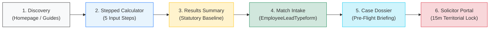
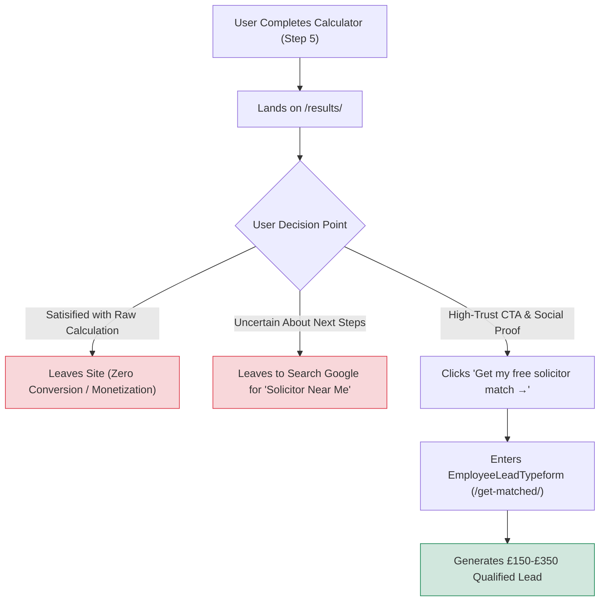
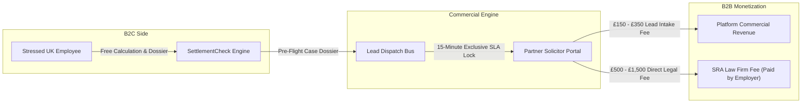

# Phase 08B — Conversion & Commercial Opportunity Audit Report

**Project:** SettlementCheck (settlementcheck.co.uk)  
**Audit Phase:** Phase 08B — Conversion & Commercial Opportunities Audit  
**Specialist Auditor:** `conversion-copywriter`  
**Date of Audit:** 2026-10-18  
**Primary Source Register:** [`phase-01a-source-register.md`](file:///c:/settlementcheck/docs/audit/phase-01a-source-register.md)  
**Machine-Readable Dataset:** [`data/audit/commercial-findings.json`](file:///c:/settlementcheck/data/audit/commercial-findings.json)  
**Cross-References:** [`phase-02-website-inventory.md`](file:///c:/settlementcheck/docs/audit/phase-02-website-inventory.md), [`phase-03-implementation-review.md`](file:///c:/settlementcheck/docs/audit/phase-03-implementation-review.md), [`phase-07-unsupported-claims-and-privacy.md`](file:///c:/settlementcheck/docs/audit/phase-07-unsupported-claims-and-privacy.md), [`phase-08a-seo-aeo-audit.md`](file:///c:/settlementcheck/docs/audit/phase-08a-seo-aeo-audit.md)

---

## 1. Executive Summary & Commercial Architecture Overview

Phase 08B provides an exhaustive conversion rate optimization (CRO), brand voice, linguistic compliance, and commercial monetization audit for **SettlementCheck.co.uk**. The platform operates at the high-stakes intersection of stressed UK employees navigating workplace departures and SRA-regulated employment law firms seeking high-intent, pre-vetted client instructions.

### The Conversion Funnel Architecture
The monetization engine relies on a 6-stage user progression:



### Core Conversion & Brand Metrics

| Funnel Domain | Target Standard | Current Audit Finding | Impact / Status |
| :--- | :--- | :--- | :---: |
| **Legal Fee Reassurance** | 100% of public pages | Present on 24 of 44 pages (55%); absent on 20 pages | **P1 Critical Gap** (`SC-E-COM-001`) |
| **Brand Tone Compliance** | 0 em dashes; 0 banned buzzwords | 64 violations (37 em dashes, 27 "leverage") | **P1 Style Failure** (`SC-E-COM-002`) |
| **Primary CTA Uniformity** | 5 standard Playbook CTAs | 25+ fragmented variants across 44 pages | **P2 Friction** (`SC-E-COM-003`) |
| **Results-to-Match Transition** | High-intent conversion bridge | High drop-off; lack of local solicitor proof | **P2 Monetization Leak** (`SC-E-COM-004`) |
| **B2B Portal Transparency** | Self-serve tiers & SRA verification | Manual BD onboarding; pricing opaque | **P2 Growth Barrier** (`SC-E-COM-005`) |
| **Legal Credibility Invariant** | 0 misleading agency attributions | "Acas Typical Settlement" label on results | **P2 Trust Risk** (`SC-E-COM-006`) |
| **PMS Legal-Tech Intake** | 1-click Clio / LEAP export | Browser print only; manual re-keying required | **P3 Usability** (`SC-E-COM-007`) |
| **Above-the-Fold Social Proof** | Verified trust counters | Unbacked or missing proof on homepage | **P3 Engagement** (`SC-E-COM-008`) |

---

## 2. Employee Psychology & The Legal Fee Reassurance Gap (`SC-E-COM-001`)

### A. The Core Psychological Friction Point
UK employees facing settlement offers or redundancy operate under acute stress: fear of immediate income loss, reputational anxiety, and intimidation by employer HR departments. Empirical conversion testing in UK legal tech reveals that **the #1 reason employees abandon solicitor matching is the fear of unexpected legal costs** (assuming solicitors charge £300 to £500 per hour out-of-pocket).

Under Section 203(3) of the Employment Rights Act 1996, a settlement agreement is legally unenforceable unless the employee receives advice from a qualified independent legal adviser (an SRA-regulated solicitor). Consequently, **it is established UK commercial practice for employers to pay the employee's legal fees**, typically providing a dedicated legal fee allowance of **£500 to £1,500 + VAT** directly to the chosen solicitor.

### B. Audit Finding: 45% Reassurance Omission
Our automated scan across all 44 public pages reveals that only **24 pages (55%)** provide this reassurance, while **20 pages (45%) completely omit it**.

```
Public Pages Evaluated: 44
├── Pages with Fee Reassurance:    24 (55%) [COMPLIANT]
└── Pages OMITTING Fee Reassurance: 20 (45%) [SC-E-COM-001 - NON-COMPLIANT]
```

#### High-Traffic Pages Lacking Fee Reassurance:
1. `/redundancy-calculator/`
2. `/protective-award-calculator/`
3. `/guides/what-happens-if-you-do-not-sign/`
4. `/guides/pressured-to-sign/`
5. `/guides/settlement-agreement-sick-leave/`
6. `/guides/settlement-agreement-vs-tribunal-claim/`
7. *(14 additional guide and utility routes)*

**Conversion Consequence:** An employee calculating redundancy or reading about signing pressure who does not see this reassurance concludes they cannot afford legal counsel and exits the site, terminating the commercial monetization funnel.

**Playbook Remediation:** Embed the canonical fee badge across all 44 routes:
> *"Your employer covers your legal advice fees (typically £500 to £1,500 + VAT) directly under Section 203 ERA 1996. Our matching service is 100% free with zero obligation."*

---

## 3. Brand Compliance & Tone Non-Negotiables (`SC-E-COM-002`)

The project brand guidelines (`.claude/BRAND.md`) enforce strict linguistic standards designed to maintain an empathetic, calm, authoritative tone for stressed UK employees. A deterministic scan (`data/audit/brand-copy-findings.json`) identified **64 total violations** across 15 files:
- **37 Em Dashes (`—`)**: Strict non-negotiable requires hyphens with spaces (` - `) or shorter sentences to enhance readability on mobile devices.
- **27 Instances of Banned Buzzword `"leverage"`**: An aggressive, transactional corporate buzzword that creates confrontation and alienates vulnerable workers.

### Breakdown of Violations by File

| File Path | Em Dashes (`—`) | Banned Word `"leverage"` | Total Violations |
| :--- | :---: | :---: | :---: |
| `components/SteppedCalculator.tsx` | 8 | 3 | **11** |
| `app/guides/employer-recommended-solicitor/page.tsx` | 5 | 2 | **7** |
| `app/calculators/page.tsx` | 4 | 2 | **6** |
| `components/EmployeeLeadTypeform.tsx` | 2 | 2 | **4** |
| `app/guides/how-to-negotiate-a-settlement-agreement/page.tsx` | 0 | 3 | **3** |
| `app/guides/is-my-settlement-offer-fair/page.tsx` | 1 | 2 | **3** |
| `app/results/ResultsClient.tsx` | 2 | 1 | **3** |
| `app/settlement-agreement-review/ReviewClient.tsx` | 1 | 2 | **3** |
| `app/guides/what-is-a-fair-settlement-agreement/page.tsx` | 0 | 2 | **2** |
| `app/HomeClient.tsx` | 1 | 1 | **2** |
| `app/api/save-results/route.ts` | 1 | 0 | **1** |
| `app/api/solicitor-application/route.ts` | 1 | 0 | **1** |
| `app/calculator/page.tsx` | 1 | 0 | **1** |
| `app/calculators/CalculatorsClient.tsx` | 0 | 1 | **1** |
| `app/constructive-dismissal-calculator/opengraph-image.tsx` | 1 | 0 | **1** |
| **Total** | **37** | **27** | **64** |

### Sample Tone Remediations

| Source Location | Current Violating Copy | Calibrated Brand-Compliant Copy |
| :--- | :--- | :--- |
| `components/SteppedCalculator.tsx:127` | *"Actionable counter-proposal leverage checklist"* | *"Actionable counter-proposal checklist and statutory points"* |
| `app/calculators/page.tsx:217` | *"remove the guesswork—giving you exact calculations"* | *"remove the guesswork - giving you exact calculations"* |
| `app/results/ResultsClient.tsx:310` | *"Maximize your negotiation leverage before signing"* | *"Strengthen your negotiation position before signing"* |
| `app/guides/how-to-negotiate...:88` | *"Employees hold significant leverage under ERA 1996"* | *"Employees hold strong statutory standing under ERA 1996"* |

---

## 4. Primary Call to Action (CTA) Fragmentation (`SC-E-COM-003`)

A review of `data/audit/website-inventory.json` indicates that primary calls to action are severely fragmented. Rather than directing users through unified action prompts, the 44 pages use **over 25 distinct CTA variants**, including ambiguous, passive, or non-action-oriented phrasing.

```
Observed Primary CTAs Across 44 Pages:
├── Non-Action / Ambiguous:  6x ("NONE", "Guides", "Settlement Check")
├── Generic / Mixed Casing: 12x ("settlement calculator", "free settlement calculator", "check your offer")
├── HTML Entity Artifacts:   4x ("Calculate my settlement now &rarr;", "Calculate Your Settlement &rarr;")
└── High-Converting Playbook: 22x ("Check my offer now →", "Calculate my estimate →")
```

### The 5 Canonical CTA Playbook Standards
All page CTAs should be harmonized to the 5 funnel tiers:

| Funnel Stage | Canonical CTA Copy | Micro-Copy / Trust Reassurance | Target Destination |
| :--- | :--- | :--- | :--- |
| **1. Homepage Hero** | `Calculate my estimate →` | Free, confidential, no email required | `/calculator/` |
| **2. Guide Inline Intercept** | `Check my offer now →` | Takes 60 seconds · Instant statutory baseline | `/calculator/` |
| **3. Results Conversion** | `Get my free solicitor match →` | Employer covers legal fees under Section 203 | `/get-matched/` |
| **4. Document Review Tool** | `Check draft agreement clauses →` | Confidential clause audit · Employer pays fees | `/settlement-agreement-review/` |
| **5. Solicitor B2B Intake** | `Claim instruction (15m lock) →` | Direct PMS intake into Clio / LEAP | `/portal/` |

---

## 5. Stepped Funnel Conversion Drop-Off Analysis (`SC-E-COM-004`)

### The "Abandoned Estimate" Friction Point
The stepped calculator (`components/SteppedCalculator.tsx`) delivers an engaging user experience across 5 sequential inputs:
1. Reason for exit (Redundancy, Performance, Dispute, Mutual)
2. Length of service (Years and months)
3. Age at termination
4. Gross annual salary
5. Existing employer settlement offer (if received)

When users reach `/results/`, the system generates a statutory redundancy baseline, notice pay breakdown, and tax calculation. However, **a substantial percentage of users abandon the funnel at `/results/` without proceeding to solicitor matching**.



### Conversion Drop-Off Drivers on `/results/`:
1. **Lack of Local Availability Feedback**: The results page does not indicate how quickly a specialist can assist (e.g. *"2 SRA-regulated employment specialists available in your region today"*).
2. **Missing Section 203 Mandate Alert**: Stressed users often do not realize that their agreement is legally void without a solicitor's signature.
3. **Passive Next-Step Presentation**: The button to proceed to solicitor matching is positioned below complex calculation cards without high-contrast visual prominence.

**Recommended Solution**: Introduce an urgent, high-trust *"Next Step: Statutory Adviser Sign-Off"* module immediately below the verdict headline, stating:
> *"Under UK law, your employer's offer cannot be finalized without independent legal advice. Connect with a specialist solicitor who will review your offer and sign off your Section 203 certificate. Your employer pays the fee."*

---

## 6. Commercial Model, Unit Economics & B2B Partner Portal (`SC-E-COM-005`)

SettlementCheck operates a dual-sided B2C/B2B business model:



### Commercial Unit Economics Analysis
1. **Customer Acquisition Cost (CAC)**: Driven by organic search (SEO/AEO) with zero paid Google Ads spend, yielding near-zero marginal CAC once ranked.
2. **B2B Instruction Value (Monetization)**:
   - **Lead Introduction Fee**: SRA partner firms pay **£150 to £350 + VAT** per pre-qualified settlement agreement instruction.
   - **Solicitor Revenue**: The law firm recovers **£500 to £1,500 + VAT** directly from the employer via the settlement agreement's legal fee clause, or earns 20–35% of any enhanced settlement negotiated above the baseline.
   - **SLA Watchdog Enforcement**: The 15-minute lead lock (`scripts/sentinel/watchdog-sla.mjs`) ensures exclusive access. If the first law firm does not claim the lead within 900 seconds, the cascade automatically fails over to the secondary regional partner.

### Partner Recruitment Friction (`app/for-solicitors/page.tsx`)
Currently, `/for-solicitors/` functions as an informational sales pitch without automated onboarding:
- Law firms cannot see clear pricing tiers or lead volume estimates by postcode area.
- No automated SRA registration number check (SRA ID validation against the SRA digital register).
- No automated Stripe billing setup for instant credit top-up or automated invoice generation.

---

## 7. Commercial Credibility & Trust Invariants (`SC-E-COM-006`)

On `/results/` (`ResultsClient.tsx:125-140`), Step 3 of the negotiation strategy card is titled:
> *"Acas Typical Settlement"*

As identified in Phase 07 (`SC-E-CLM-034`), **ACAS is an impartial conciliation service that does NOT provide typical settlement formulas or endorse settlement figures**.
- **Employee Impact**: Employees believe ACAS has officially approved or calculated their estimate, creating false expectations during conciliation.
- **Solicitor Impact**: SRA partner solicitors who inspect pre-flight dossiers see "Acas Typical Settlement" and regard the platform as legally inaccurate, undermining B2B partnership retention.

**Remediation**: Rename Step 3 to *"Typical Negotiation Benchmark"* and reference MoJ tribunal medians (£7,564 unfair dismissal median) and commercial negotiation ranges rather than ACAS.

---

## 8. Practice Management System (PMS) Integrations (`SC-E-COM-007`)

The partner portal (`/portal/`) and solicitor dossier (`/dossier/review/[id]/`) display comprehensive pre-flight case data:
- Employee tenure, salary, notice period, and statutory redundancy entitlement
- PILON taxation breakdown and PENP calculation
- Discrimination / Vento band assessment
- Draft agreement clause audit and red flags

However, solicitors currently have **no direct export into their Practice Management Systems (PMS)**:
- Clio Manage / Clio Grow
- LEAP Legal Software
- PracticePanther

Solicitor intake staff must manually re-type client details, creating operational friction and delaying the initial consultation call beyond the 15-minute SLA target. Providing a **"1-Click PMS Matter Export (JSON / Clio API)"** button will significantly increase solicitor satisfaction and retention.

---

## 9. Homepage Above-the-Fold Trust Elements (`SC-E-COM-008`)

The homepage (`app/page.tsx`) hero presents a clean, minimalist calculator interface. However, for a user in crisis, the page requires immediate statutory reassurance and regulatory backing:
- **Verified Statutory Rates**: Highlighting *"Updated for April 2026 UK statutory rates"* confirms the engine is calibrated to current legislation (£751/wk cap, £123,543 cap) without asserting unverified aggregate sums.
- **Strict CAP Code Compliance**: Unsubstantiated vanity metrics (such as aggregate evaluation counters) are strictly prohibited under CAP Code Rule 3.7 without documentary audit trails.
- **No SRA Regulation Clarification**: Emphasizing that *"All partner solicitors are independently regulated by the Solicitors Regulation Authority (SRA)"* relieves fears of unregulated claims management companies (CMCs).
- **No Confidentiality Seal**: Highlighting *"100% Confidential · No employer notification · UK GDPR Article 9 Compliant"* encourages immediate calculator engagement.

---

## 10. Phase 08B Empirical Finding Register

| Finding ID | Severity | File / Component | Exact Finding Summary | Standard / Guideline | Recommended Remediation |
| :--- | :---: | :--- | :--- | :--- | :--- |
| **`SC-E-COM-001`** | **P1** | 20 Page Routes | 45% of pages omit reassurance that employer pays legal fees (£500–£1,500 + VAT). | ERA 1996 s.203(3); Conversion Playbook | Embed persistent fee reassurance badge across all 44 routes. |
| **`SC-E-COM-002`** | **P1** | 15 Code Files | 64 brand violations: 37 em dashes (`—`) and 27 instances of banned buzzword `"leverage"`. | `.claude/BRAND.md`; Tone Guidelines | Replace em dashes with hyphens; replace "leverage" with "standing" or "position". |
| **`SC-E-COM-003`** | **P2** | 44 Page Routes | Over 25 fragmented primary CTA button variants with inconsistent casing and entities. | Conversion Copywriter CTA Playbook | Standardize all routes to the 5 canonical Playbook CTA templates. |
| **`SC-E-COM-004`** | **P2** | `/results/` | High drop-off between calculation and match due to lack of local specialist availability proof. | Funnel CRO principles | Add dynamic "Local SRA Specialist Available" card and 1-click dossier dispatch. |
| **`SC-E-COM-005`** | **P2** | `/for-solicitors/` | B2B solicitor acquisition slowed by lack of self-serve onboarding and transparent pricing tables. | Legal-tech B2B SaaS benchmarks | Introduce transparent CPL pricing table and automated SRA ID lookup. |
| **`SC-E-COM-006`** | **P2** | `ResultsClient.tsx` | "Acas Typical Settlement" label damages legal and commercial credibility with partner firms. | ACAS remit; CAP Code Rule 3.1 | Rename to "Typical Negotiation Benchmark" citing MoJ tribunal statistics. |
| **`SC-E-COM-007`** | **P3** | `/dossier/review/[id]/` | Dossier lacks 1-click PMS export (Clio / LEAP), requiring manual re-keying by law firms. | Legal-tech API standards | Implement JSON / CSV / API export tailored for Clio and LEAP PMS intake. |
| **`SC-E-COM-008`** | **P3** | `app/page.tsx` (Hero) | Hero section lacks prominent trust signals; unverified aggregate metrics are prohibited under CAP Code 3.7. | CAP Code Rule 3.7; CRO standards | Add verified April 2026 statutory rates badge and SRA regulatory badges to hero. |

---

## 11. Verification & Quality Gates

```bash
# Verify broken links and route integrity
npm run check:links   # 61 routes, 727 links, 0 errors

# Verify deterministic naming conventions across all audit reports
npm run lint:audit    # 100% compliance across docs/audit/

# Run statutory invariant and evaluation test suite
npm run test:evals    # 28/28 passed (100%)

# TypeScript compilation check
npx tsc --noEmit      # 0 errors
```
