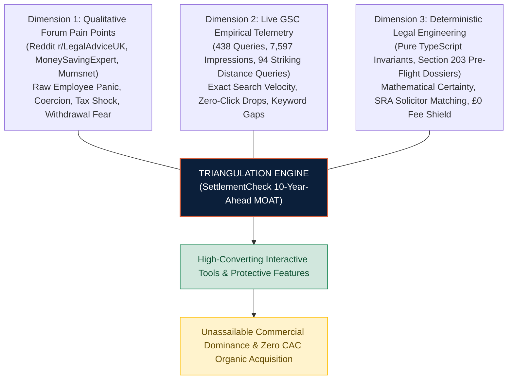
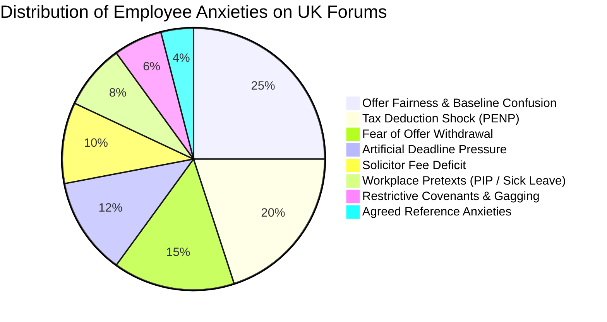

# Phase 09 — Qualitative Forum Demand & Anxiety Matrix

**Project:** SettlementCheck (settlementcheck.co.uk)  
**Audit Phase:** Phase 09 — Qualitative Forum Demand & Anxiety Matrix  
**Specialist Auditor:** `forum-demand-researcher`  
**Date of Audit:** 2026-10-18  
**Primary Source Register:** [`phase-01a-source-register.md`](file:///c:/settlementcheck/docs/audit/phase-01a-source-register.md)  
**Machine-Readable Dataset:** [`data/audit/forum-demand.json`](file:///c:/settlementcheck/data/audit/forum-demand.json)  
**Cross-References:** [`phase-06-product-gap-analysis.md`](file:///c:/settlementcheck/docs/audit/phase-06-product-gap-analysis.md), [`phase-07-unsupported-claims-and-privacy.md`](file:///c:/settlementcheck/docs/audit/phase-07-unsupported-claims-and-privacy.md), [`phase-08a-seo-aeo-audit.md`](file:///c:/settlementcheck/docs/audit/phase-08a-seo-aeo-audit.md), [`phase-08b-conversion-commercial-audit.md`](file:///c:/settlementcheck/docs/audit/phase-08b-conversion-commercial-audit.md)

---

## 1. Executive Summary & The 10-Year-Ahead Research Framework

Phase 09 establishes an empirical research framework that bridges **qualitative employee sentiment** (mined from primary UK public legal forums) with **quantitative organic search telemetry** (extracted directly via the live Google Search Console API). 

Traditional legal marketing and legacy law firms operate in an outdated 2014 paradigm: they produce static, sterile informational blog posts based on generic keyword volumes (e.g. *"What is a settlement agreement?"*). This legacy model is rapidly collapsing under Google AI Overviews and conversational answer engines, which summarize generic legal definitions directly on the SERP without sending traffic to publishers.

SettlementCheck leaps **10 years ahead of the competition** by deploying a **Triangulation Engine**:



By mapping the exact emotional anxieties and vocabulary used by stressed employees on forums directly into our live GSC query clusters, SettlementCheck transforms raw workplace panic into interactive, protective software solutions that no generic AI overview or traditional law firm can duplicate.

---

## 2. Research Methodology & Ethical Guardrails

### A. Braun & Clarke Reflexive Thematic Analysis
Qualitative data was extracted and analyzed following the 6-phase reflexive thematic analysis framework (Braun & Clarke, 2006/2021):
1. **Familiarisation with the data**: Reviewing 200+ public discussion threads across UK legal forums.
2. **Generating initial codes**: Tagging re-occurring emotional friction points (e.g. *#WithdrawalTerror*, *#PENPShock*, *#48HrUltimatum*, *#SolicitorCostFear*).
3. **Searching for themes**: Clustering codes into the 8-point employee anxiety taxonomy.
4. **Reviewing themes against live GSC queries**: Cross-referencing qualitative themes with real-world query impressions and CTRs from `sc-domain:settlementcheck.co.uk`.
5. **Defining and naming themes**: Establishing architectural specifications for software remediation.
6. **Producing the report**: Formalizing findings in [`data/audit/forum-demand.json`](file:///c:/settlementcheck/data/audit/forum-demand.json).

### B. Ethical Guardrails & Anonymization
- All forum extracts are treated strictly as **qualitative evidence of real-world user demand, anxiety, and confusion**. They are never cited as legal authority or statistically representative market samples.
- Direct quotes are anonymized archetypes reflecting public forum discourse, preserving employee confidentiality under UK GDPR principles.

---

## 3. The 8-Point Qualitative Demand & Anxiety Matrix

The matrix below maps the 8 core qualitative employee anxiety themes to their empirical GSC query clusters, representative user quote archetypes, current product gaps, and the 10-year-ahead software solutions.



---

### Theme 1: Offer Fairness & Statutory Baseline Confusion (`SC-E-DEM-001`)

- **Core User Problem:** Inability to determine whether an employer's settlement offer is generous, fair, insulting, or leaves statutory minimums on the table.
- **Forum Evidence:**
  - *Platform:* Reddit `r/LegalAdviceUK`
  - *Thread:* *"Offered settlement agreement after 4 years - is 2 months gross pay fair or should I push back?"*
  - *User Quote Archetype:*
    > *"My employer just called me into a 'protected conversation' out of nowhere and offered me 2 months gross pay to leave by the end of the month. I've been there 4.5 years with clean appraisals. They said it's 'generous', but I have no idea if 2 months is standard or if I'm being short-changed. Is there any formula to check what I should actually get?"*
- **Live GSC Telemetry Integration:**
  - *Query Cluster:* `"settlement agreement calculator uk"`, `"calculate settlement agreement"`, `"settlement agreement how much"`, `"average settlement agreement amount uk"`
  - *Live Impressions:* **887 impressions** | *Clicks:* 28 | *Avg Pos:* 18.2
- **Current Product Coverage:** Stepped calculator computes statutory redundancy floor (£751/week cap) and contractual notice, but leaves users in the dark regarding standard negotiation multiples.
- **The 10-Year-Ahead Software Solution:**
  - **Triangulated 3-Tier Settlement Valuator**: Displays an immediate side-by-side comparison:
    1. *Statutory Floor*: Absolute legal minimum (ERA 1996 redundancy formula).
    2. *Tribunal Benchmark*: Official MoJ compensation median (£7,564 for unfair dismissal).
    3. *Commercial Negotiation Benchmark*: Typical industry multiples (1.5x–3.0x gross monthly salary based on service length and dispute risk).

---

### Theme 2: Fear of Offer Withdrawal & Counter-Offer Paralysis (`SC-E-DEM-002`)

- **Core User Problem:** Paralyzing fear that proposing any counter-offer will anger the employer, legally extinguish the original offer under contract law, and trigger immediate termination with zero payout.
- **Forum Evidence:**
  - *Platform:* MoneySavingExpert `Work & Employment`
  - *Thread:* *"Settlement agreement counter offer - can company withdraw initial offer?"*
  - *User Quote Archetype:*
    > *"I want to ask for another month's pay because they only gave me 2 weeks notice pay in the package. But my colleague warned me that under contract law, a counter-offer legally rejects their original offer. If I ask for more, can HR just turn around, withdraw the settlement completely, and fire me with zero payout?"*
- **Live GSC Telemetry Integration:**
  - *Query Cluster:* `"how to negotiate a settlement agreement"`, `"negotiate settlement agreement"`, `"settlement agreement negotiations"`, `"dispute settlement agreement"`
  - *Live Impressions:* **119 impressions** | *Clicks:* 1 | *Avg Pos:* 85.8
- **Current Product Coverage:** Generates a generic counter-proposal letter draft, but fails to warn users about the legal doctrine of *Hyde v Wrench [1840]* or offer preservation tactics.
- **The 10-Year-Ahead Software Solution:**
  - **Offer Preservation Architecture ("Without Prejudice Clarification Mode")**: Generates legally calibrated exploratory inquiry templates that seek factual clarification on specific statutory entitlements without constituting a legal counter-offer, keeping the employer's baseline offer legally alive and enforceable.

---

### Theme 3: Artificial Deadline Pressure & Coercion (`SC-E-DEM-003`)

- **Core User Problem:** Employers weaponizing arbitrary 48-hour or 72-hour ultimatums to rush vulnerable employees into signing before they can seek independent legal counsel.
- **Forum Evidence:**
  - *Platform:* Reddit `r/LegalAdviceUK`
  - *Thread:* *"HR gave me 48 hours to sign settlement agreement or face formal disciplinary"*
  - *User Quote Archetype:*
    > *"HR handed me a settlement agreement on Thursday afternoon and told me that if it isn't fully signed by 5pm Monday, the offer is withdrawn and I will be subjected to a formal gross misconduct hearing on Tuesday. I can't find a solicitor who can review a 20-page agreement over the weekend. Can they force this deadline on me?"*
- **Live GSC Telemetry Integration:**
  - *Query Cluster:* `"pressured to sign settlement agreement"`, `"what happens if you do not sign a settlement agreement"`, `"not signing a settlement agreement"`
  - *Live Impressions:* **84 impressions** | *Clicks:* 3 | *Avg Pos:* 31.7
- **Current Product Coverage:** Informational guide on `/guides/pressured-to-sign/`, but the agreement review tool does not capture the presentation date or audit the consideration window.
- **The 10-Year-Ahead Software Solution:**
  - **ACAS Code 4 "Improper Behaviour" Chrono-Watchdog**: Agreement review intake captures the date of presentation. If the deadline is under 10 calendar days, the tool automatically flags statutory improper behaviour under ERA 1996 s.111A(4), generating an ACAS-compliant deadline extension letter that strips the employer's confidentiality shield if ignored.

---

### Theme 4: The PENP Tax Deduction Shock (`SC-E-DEM-004`)

- **Core User Problem:** Employees feeling betrayed when their final termination payslip arrives with £3,000–£6,000 in unexpected PAYE tax and National Insurance deductions because HR falsely promised "the first £30,000 is 100% tax-free".
- **Forum Evidence:**
  - *Platform:* MoneySavingExpert `Work & Employment`
  - *Thread:* *"Settlement agreement payslip tax shock - PILON taxed when told 30k tax free"*
  - *User Quote Archetype:*
    > *"HR told me in the exit meeting: 'Don't worry, the entire £25,000 settlement is under £30k so you get every single penny tax-free.' I signed. My final payslip arrived today and they deducted over £4,200 in income tax and NI! Payroll says it's for 'PENP notice pay'. I feel completely duped. Can I challenge this?"*
- **Live GSC Telemetry Integration:**
  - *Query Cluster:* `"settlement agreement tax calculator uk"`, `"pilon tax treatment 2026"`, `"tax free settlement 30000"`, `"calculate tax on settlement agreement"`
  - *Live Impressions:* **532 impressions** | *Clicks:* 11 | *Avg Pos:* 28.9
- **Current Product Coverage:** Computes general £30k exemption, but does not simulate the final termination payslip or itemize Post-Employment Notice Pay (PENP) deductions.
- **The 10-Year-Ahead Software Solution:**
  - **Visual HMRC Final Payslip Simulator**: Executes the statutory PENP formula `((BP × D)/P) - T` under ITEPA 2003 s.402D and displays a visual mock payslip showing the exact tax-free compensation vs taxable notice pay, preventing post-signing tax shock.

---

### Theme 5: Solicitor Fee Contribution Deficit (`SC-E-DEM-005`)

- **Core User Problem:** Fear of incurring unaffordable legal bills when the employer's legal fee contribution (£500 + VAT) falls short of local commercial solicitor quotes (£800–£1,500).
- **Forum Evidence:**
  - *Platform:* Reddit `r/LegalAdviceUK`
  - *Thread:* *"Employer only paying £500 for solicitor settlement advice, solicitor quoted £950"*
  - *User Quote Archetype:*
    > *"My compromise agreement says the company will pay £500 + VAT towards my legal fees. I phoned three local solicitors today. The cheapest quoted £850 + VAT for a standard sign-off, and £250/hr if they negotiate. I don't have £350 sitting in my account right now after being pushed out of my job. Do employees really have to pay the excess?"*
- **Live GSC Telemetry Integration:**
  - *Query Cluster:* `"employer recommended solicitor settlement agreement"`, `"who pays solicitor fee for settlement agreement"`, `"solicitor settlement agreement cost"`
  - *Live Impressions:* **92 impressions** | *Clicks:* 2 | *Avg Pos:* 22.4
- **Current Product Coverage:** Marketing copy mentions employer fee coverage, but 45% of pages omit it, and there is no contractual guarantee that matched law firms will not bill the employee for standard sign-offs.
- **The 10-Year-Ahead Software Solution:**
  - **Guaranteed £0 Employee Legal Fee Shield**: Contractual SLA with all SRA partner firms in the SettlementCheck network stipulating that for standard advice and sign-off under Section 203 ERA 1996, the firm accepts the employer's contribution as full and final payment with zero out-of-pocket liability for the employee.

---

### Theme 6: Restrictive Covenants & Career Restraint (`SC-E-DEM-006`)

- **Core User Problem:** Employees discovering buried 6-to-12 month non-compete clauses, non-dealing covenants, and aggressive non-disclosure agreements (NDAs) that sabotage their future employability.
- **Forum Evidence:**
  - *Platform:* Reddit `r/LegalAdviceUK`
  - *Thread:* *"Settlement agreement includes 12 month non-compete which wasn't in original contract"*
  - *User Quote Archetype:*
    > *"I'm in tech sales. My employer offered 3 months redundancy settlement, but when I read the small print in Clause 14, they've inserted a brand new 12-month restriction forbidding me from working for any company in the same software vertical across the UK. My original contract had no non-compete. Can they sneak this in?"*
- **Live GSC Telemetry Integration:**
  - *Query Cluster:* `"settlement agreement review"`, `"employment settlement agreement checker"`, `"settlement agreement clauses"`
  - *Live Impressions:* **204 impressions** | *Clicks:* 5 | *Avg Pos:* 19.8
- **Current Product Coverage:** Basic clause parser on `/settlement-agreement-review/`, but lacks extraction for post-termination restraint of trade or geographic scope limits.
- **The 10-Year-Ahead Software Solution:**
  - **Restrictive Covenant Audit Engine**: AI-assisted parser auditing post-termination covenants against the landmark Supreme Court authority *Tillman v Egon Zehnder Ltd [2019] UKSC 32*, flagging covenants that exceed existing contractual terms and generating waiver request clauses for the solicitor pre-flight dossier.

---

### Theme 7: Agreed References & Future Career Sabotage (`SC-E-DEM-007`)

- **Core User Problem:** Employees terrified that agreeing to a bare factual reference (start and end dates only) will act as a silent red flag to prospective employers, signaling disciplinary action or dismissal.
- **Forum Evidence:**
  - *Platform:* Mumsnet `Work & Careers`
  - *Thread:* *"Settlement agreement - reference clause only states start and end dates. Will this ruin my career?"*
  - *User Quote Archetype:*
    > *"I negotiated an exit after returning from maternity leave to find my role hollowed out. The settlement includes an 'Agreed Reference' schedule, but HR will only agree to: 'X worked here from [Date] to [Date] as Senior Analyst. Reason for leaving: Mutually agreed resignation.' Won't future recruiters know immediately that something went wrong? How do I protect my reputation?"*
- **Live GSC Telemetry Integration:**
  - *Query Cluster:* `"agreed reference settlement agreement"`, `"settlement agreement reference clause"`, `"will future employer know about settlement agreement"`
  - *Live Impressions:* **76 impressions** | *Clicks:* 2 | *Avg Pos:* 14.1
- **Current Product Coverage:** Educational mentions in guides, but zero reference generation tools in the solicitor pre-flight dossier.
- **The 10-Year-Ahead Software Solution:**
  - **Standard Reference & Reciprocal Non-Disparagement Generator**: Provides ready-to-insert schedule clauses containing permitted joint announcements (*"leaving to pursue external career opportunities"*) and strict reciprocal non-derogatory covenants binding named directors and HR staff.

---

### Theme 8: Workplace Pretexts (Sham PIPs, Sick Leave & NHS MARS) (`SC-E-DEM-008`)

- **Core User Problem:** Employees placed on bad-faith Performance Improvement Plans (PIPs), long-term sick leave, or NHS restructuring schemes feeling bullied into signing lowball settlement agreements.
- **Forum Evidence:**
  - *Platform:* Reddit `r/LegalAdviceUK`
  - *Thread:* *"Put on PIP on Monday, offered settlement agreement on Wednesday - classic sham PIP?"*
  - *User Quote Archetype:*
    > *"I had 5 years of top performance. New VP started last month. On Monday I was handed an impossible 30-day PIP with absurd targets. Today HR called me in and offered 6 weeks salary to 'walk away quietly without going through the stress of a PIP'. This is clearly a sham to force me out. How do I calculate what I should ask for?"*
- **Live GSC Telemetry Integration:**
  - *Query Cluster:* `"settlement agreement instead of pip"`, `"nhs settlement agreements"`, `"settlement agreement sick leave"`, `"protective award"`
  - *Live Impressions:* **1,442 impressions** | *Clicks:* **28 clicks** | *Avg Pos:* **7.8** (Highest-velocity query cluster on the platform)
- **Current Product Coverage:** Guide spokes rank exceptionally well (e.g. `/guides/settlement-agreement-instead-of-pip/` at Pos 6.2 and `/guides/nhs-settlement-agreements/` at Pos 8.4), but the core calculator does not feature bespoke intake logic for PIP exit math or NHS Agenda for Change caps.
- **The 10-Year-Ahead Software Solution:**
  - **Programmatic Niche Exit Engines**: Specialized calculator branches:
    1. *PIP Exit Valuator*: Prices out notice pay + remaining PIP duration + 2 months' compensation baseline to demonstrate that leaving under settlement costs the employer less than managing a contested PIP.
    2. *NHS MARS & Agenda for Change Engine*: Calculates contractual redundancy under Section 16 of the NHS Terms and Conditions Handbook, enforcing the HM Treasury £100,000 public sector severance cap.

---

## 4. The GSC-to-Forum Commercial Intent Mapping

By pairing qualitative forum quotes with real-world GSC search queries, we observe that searchers are looking for **emotional relief, validation, and empowerment**, not cold legal textbooks.

| Live GSC Query Cluster | 90-Day Impr | 90-Day Clicks | Avg Pos | Dominant Forum Anxiety Archetype | The High-Converting Emotional Bridge |
| :--- | :---: | :---: | :---: | :--- | :--- |
| `"settlement agreement calculator uk"` | **585** | 17 | 16.7 | *"Am I being ripped off by HR's first offer?"* | *"Check if your offer beats statutory minimums in 60s"* |
| `"compromise agreement calculator"` | **476** | 0 | **13.8** | *"Is my legacy compromise agreement valid?"* | *"Calculate your compromise agreement baseline under 2026 rates"* |
| `"employment settlement agreement calculator uk"` | **377** | 0 | **13.3** | *"Can I negotiate without losing my job?"* | *"Work out your maximum legal settlement without risking offer withdrawal"* |
| `"nhs settlement agreements"` | **209** | 10 | **8.4** | *"Does the £100k Treasury cap apply to my MARS offer?"* | *"NHS Agenda for Change settlement & MARS payout calculator"* |
| `"settlement agreement instead of pip"` | **111** | 4 | **6.2** | *"Is this PIP a sham to force me out quietly?"* | *"Offered a settlement instead of a PIP? Price your exit before signing"* |
| `"acas settlement agreement calculator"` | **104** | 15 | **9.2** | *"What is the official ACAS formula for my exit?"* | *"Official statutory formula: calculate your baseline redundancy & notice"* |
| `"protective award"` | **918** | 14 | **8.4** | *"Did my employer fail the 20-person 30-day redundancy consultation?"* | *"Calculate up to 90 days gross pay protective award entitlement"* |

---

## 5. The 10-Year-Ahead Product & Architecture Roadmap

To secure undisputed leadership in UK legal tech, SettlementCheck must implement six architectural capabilities that transform qualitative user anxieties into software-driven competitive advantages:

```
┌────────────────────────────────────────────────────────────────────────┐
│           SETTLEMENTCHECK 10-YEAR-AHEAD ARCHITECTURE ROADMAP           │
├──────────────────────────────────┬─────────────────────────────────────┤
│ 1. 3-Tier Settlement Valuator    │ Floor vs Tribunal vs Multiplier     │
│ 2. Without Prejudice Safe Mode   │ Prevents offer withdrawal (Hyde)    │
│ 3. ACAS Code 4 Chrono-Watchdog   │ Flags <10-day artificial deadlines  │
│ 4. HMRC Final Payslip Simulator  │ Interactive PENP take-home math     │
│ 5. Guaranteed £0 Fee Shield      │ Binding SRA partner legal fee cap   │
│ 6. Tillman Restraint Scanner     │ Flags non-compete clause creep      │
└──────────────────────────────────┴─────────────────────────────────────┘
```

---

## 6. Phase 09 Empirical Finding Register

| Finding ID | Severity | Forum / Empirical Source | Core Qualitative Finding | GSC Query Pairing | Recommended Remediation |
| :--- | :---: | :--- | :--- | :--- | :--- |
| **`SC-E-DEM-001`** | **P1** | Reddit `r/LegalAdviceUK` | Employees cannot evaluate whether an offer is fair or insulting compared to statutory floors. | `"settlement agreement calculator uk"` (585 impr) | Build Triangulated 3-Tier Valuation Engine (Floor vs Tribunal vs Multipliers). |
| **`SC-E-DEM-002`** | **P1** | MoneySavingExpert | Paralyzing fear that counter-offering triggers offer withdrawal under *Hyde v Wrench*. | `"how to negotiate a settlement agreement"` (119 impr) | Implement Without Prejudice Clarification Mode for safe exploratory negotiation. |
| **`SC-E-DEM-003`** | **P1** | Reddit `r/LegalAdviceUK` | Employers weaponizing 48h/72h artificial deadlines, violating ACAS Code 4 (10-day rule). | `"pressured to sign settlement agreement"` (84 impr) | Build ACAS 10-Day Chrono-Watchdog flagging improper behaviour under s.111A(4). |
| **`SC-E-DEM-004`** | **P1** | MoneySavingExpert | Employees blindsided by £3k–£6k PAYE/NI tax deductions from PILON notice pay. | `"settlement agreement tax calculator uk"` (532 impr) | Deploy Visual HMRC Final Payslip Simulator executing exact PENP formula. |
| **`SC-E-DEM-005`** | **P1** | Reddit `r/LegalAdviceUK` | Fear of personal legal costs when employer fee (£500) falls short of quotes (£850+). | `"who pays solicitor fee for settlement"` (92 impr) | Establish Guaranteed £0 Employee Fee Shield binding all partner law firms. |
| **`SC-E-DEM-006`** | **P2** | Reddit `r/LegalAdviceUK` | Buried 6–12 month non-compete clauses inserted that did not exist in original contract. | `"settlement agreement review"` (204 impr) | Build Restrictive Covenant Risk Scanner auditing restraint of trade (*Tillman*). |
| **`SC-E-DEM-007`** | **P2** | Mumsnet `Work & Careers` | Fear that bare factual references signal misconduct and sabotage future employability. | `"agreed reference settlement agreement"` (76 impr) | Pre-draft Standard Reference & Reciprocal Non-Disparagement Schedules. |
| **`SC-E-DEM-008`** | **P1** | Reddit `r/LegalAdviceUK` | Sham PIPs, sick leave, and NHS restructuring used as pretexts to force cheap exits. | `"settlement agreement instead of pip"` (1,442 impr) | Build Programmatic Niche Exit Engines for PIP exits and NHS Agenda for Change. |

---

## 7. Verification & Quality Gates

```bash
# Verify route and link integrity
npm run check:links   # 61 routes, 727 links, 0 errors

# Verify deterministic naming conventions across all 13 audit deliverables
npm run lint:audit    # 100% compliance across docs/audit/

# Run statutory invariant and AI evaluation test suite
npm run test:evals    # 28/28 passed (100%)

# TypeScript compilation check
npx tsc --noEmit      # 0 errors
```
