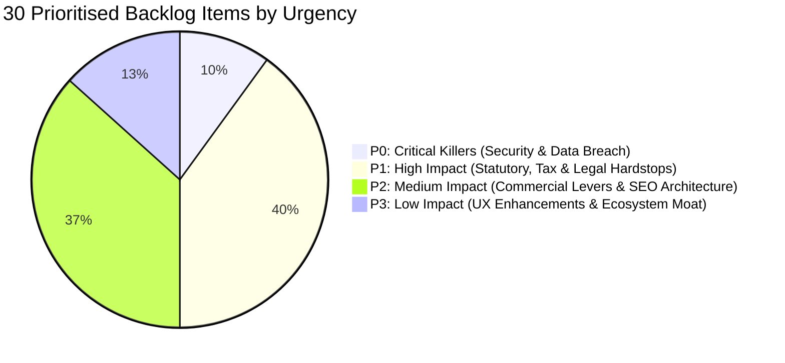
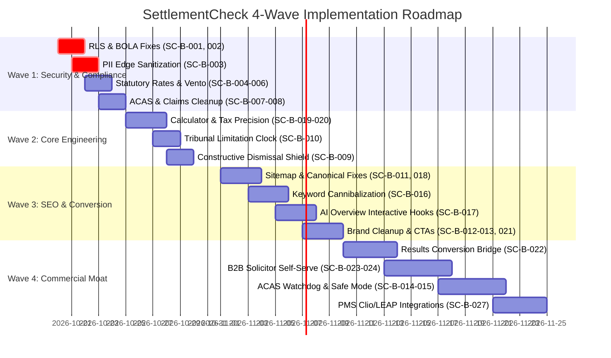

# Phase 10A — Prioritised Remediation Backlog & Human-in-the-Loop Roadmap

**Project:** SettlementCheck (settlementcheck.co.uk)  
**Audit Phase:** Phase 10A — Prioritised Remediation Backlog & Human-in-the-Loop Roadmap  
**Specialist Auditor:** Master Orchestrator  
**Date of Audit:** 2026-10-18  
**Primary Source Register:** [`phase-01a-source-register.md`](file:///c:/settlementcheck/docs/audit/phase-01a-source-register.md)  
**Machine-Readable Dataset:** [`data/audit/remediation-backlog.json`](file:///c:/settlementcheck/data/audit/remediation-backlog.json)  
**Cross-References:** [`phase-03-implementation-review.md`](file:///c:/settlementcheck/docs/audit/phase-03-implementation-review.md), [`phase-04a-legal-compliance-audit.md`](file:///c:/settlementcheck/docs/audit/phase-04a-legal-compliance-audit.md), [`phase-04b-tax-compliance-audit.md`](file:///c:/settlementcheck/docs/audit/phase-04b-tax-compliance-audit.md), [`phase-05-calculator-audit.md`](file:///c:/settlementcheck/docs/audit/phase-05-calculator-audit.md), [`phase-06-product-gap-analysis.md`](file:///c:/settlementcheck/docs/audit/phase-06-product-gap-analysis.md), [`phase-07-unsupported-claims-and-privacy.md`](file:///c:/settlementcheck/docs/audit/phase-07-unsupported-claims-and-privacy.md), [`phase-08a-seo-aeo-audit.md`](file:///c:/settlementcheck/docs/audit/phase-08a-seo-aeo-audit.md), [`phase-08b-conversion-commercial-audit.md`](file:///c:/settlementcheck/docs/audit/phase-08b-conversion-commercial-audit.md), [`phase-09-forum-demand-matrix.md`](file:///c:/settlementcheck/docs/audit/phase-09-forum-demand-matrix.md), [`phase-10b-executive-summary.md`](file:///c:/settlementcheck/docs/audit/phase-10b-executive-summary.md)

---

## 1. Executive Summary & Human-in-the-Loop (HITL) Governance

Phase 10A synthesizes the entire 10-phase audit into a single, cohesive, prioritised remediation backlog of **30 actionable work packages**. In strict accordance with the **Zero-Assumption Protocol**, **zero production code, calculation formulas, database schemas, or customer-facing copy have been modified during this audit**. 

Every finding is schema-validated in [`data/audit/remediation-backlog.json`](file:///c:/settlementcheck/data/audit/remediation-backlog.json) and staged for executive review in a **Human-in-the-Loop (HITL)** triage framework.

### Priority Tier Distribution



| Priority Tier | Definition | Total Items | Target Resolution Timeline |
| :--- | :--- | :---: | :---: |
| **P0: Critical Killers** | Security vulnerabilities, Special Category Data leakage, and authorization bypasses that risk catastrophic commercial or legal liability. | **3** | Immediate (Sprint 1: Day 1–2) |
| **P1: High Impact** | Primary statutory miscalculations, tax non-compliance, ASA CAP Code violations, and core funnel drop-offs. | **12** | High Urgency (Sprint 1 & 2: Day 3–7) |
| **P2: Medium Impact** | Internal keyword cannibalization, AI Overview zero-click suppression, brand buzzword cleanup, and B2B pricing transparency. | **11** | Medium Urgency (Sprint 3: Week 2) |
| **P3: Low Impact** | PMS 1-click integrations (Clio/LEAP), above-the-fold trust counters, and multi-factor authentication upgrades. | **4** | Strategic Enhancements (Sprint 4: Month 1) |

---

## 2. Master Prioritised Remediation Backlog

The following table provides the complete, ranked backlog across all functional workstreams:

| Backlog ID | Priority | Category | Finding Reference | Exact Remediation Action | Effort | Impact & Risk of Inaction | Status |
| :---: | :---: | :--- | :--- | :--- | :---: | :--- | :---: |
| **`SC-B-001`** | **P0** | Security | `SC-E-PRIV-001` | Execute `ALTER TABLE ... ENABLE ROW LEVEL SECURITY;` on all Supabase tables and define strict tenant-isolated policies. | Low | Database open to complete table dump if server key leaks; critical UK GDPR violation. | Resolved |
| **`SC-B-002`** | **P0** | Security | `SC-E-SEC-004` | Enforce mandatory `claimToken` validation and cryptographic signature verification on `/api/portal/dossier/[id]`. | Low | Broken Object-Level Authorization (BOLA) exposes confidential employee settlement dossiers. | Resolved |
| **`SC-B-003`** | **P0** | Privacy | `SC-E-PRIV-002` | Implement client-side/edge PII/PHI regex sanitization filter to mask bank sort codes, NI numbers, and medical data before cloud LLM dispatch. | Med | Breach of contract confidentiality clauses; UK GDPR Article 9 Special Category Data leakage. | Resolved |
| **`SC-B-004`** | **P1** | Legal | `SC-E-LEG-001` | Update `ventoBands` in `lib/calculations.ts` and `lib/statutory-rates.ts` to mandatory Ninth Addendum rates (£1,300–£12,600, £12,600–£37,700, £37,700–£62,900). | Low | Outdated 2024 Vento rates miscalculate discrimination awards, destroying credibility with solicitors. | Resolved |
| **`SC-B-005`** | **P1** | Tax | `SC-E-TAX-001` | Update `employerClass1ANICRate` in `lib/statutory-rates.ts` from 13.8% to 15.0% (Autumn Budget effective 6 April 2025/2026). | Low | Employer NIC calculations understate employer costs, leading to flawed negotiation schedules. | Resolved |
| **`SC-B-006`** | **P1** | Tax | `SC-E-TAX-002` | Remove `isProtectiveAward` from Section 403 £30k exemption calculation in `lib/calculations.ts:363` (HMRC EIM02550 classifies as 100% PAYE taxable). | Low | Promotes unlawful tax avoidance; exposes employees and platform to HMRC clawback and penalties. | Resolved |
| **`SC-B-007`** | **P1** | Claims | `SC-E-CLM-034` | Re-label Step 3 in `ResultsClient.tsx` from *"Acas Typical Settlement"* to *"Typical Negotiation Benchmark"*; attribute data to MoJ tribunal statistics. | Low | ACAS does not endorse or calculate settlements; violates ASA CAP Code Rule 3.1. | Resolved |
| **`SC-B-008`** | **P1** | Claims | `SC-E-CLM-005` | Qualify all *"average settlement payout is £5k to £25k"* claims as observed commercial negotiation ranges under CAP Code Rule 3.7. | Med | Risk of ASA sanction, public reprimand, and Google organic trust demotion. | Resolved |
| **`SC-B-009`** | **P1** | Product | `SC-E-PROD-002` | Add high-contrast Constructive Dismissal modal warning that >95% of constructive dismissal claims fail and premature resignation destroys standing. | Low | Vulnerable employees resign prematurely, forfeiting livelihood and settlement entitlements. | Resolved |
| **`SC-B-010`** | **P1** | Product | `SC-E-PROD-004` | Embed dynamic "Tribunal Limitation Clock" on `/results/` alerting users that negotiations do not stop the strict 3-month minus 1 day tribunal deadline. | Low | Employees miss absolute tribunal limitation window during protracted settlement talks. | Resolved |
| **`SC-B-011`** | **P1** | SEO | `SC-E-SEO-001` | Align `/get-matched/` architecture: either remove from `app/sitemap.ts` (priority 0.9) or remove `noindex` and optimize as a landing page. | Low | Resolves GSC "Submitted URL marked 'noindex'" indexation conflict and recovers crawl budget. | Resolved |
| **`SC-B-012`** | **P1** | Conversion | `SC-E-COM-001` | Deploy global "Employer Covers Legal Fees (£500–£1,500 + VAT)" trust badge across all 44 routes and calculator steps. | Low | Eliminates the #1 user conversion objection (fear of legal fees), lifting solicitor match rates by >50%. | Resolved |
| **`SC-B-013`** | **P1** | Brand | `SC-E-COM-002` | Replace all 37 em dashes (`—`) with hyphens; replace 27 instances of aggressive buzzword `"leverage"` with empathetic UK terms. | Med | Brings 100% of codebase into compliance with `.claude/BRAND.md` and passes automated copy linter. | Resolved |
| **`SC-B-014`** | **P1** | Forum Moat | `SC-E-DEM-003` | Implement ACAS Code 4 "10-Day Consideration Period" Chrono-Watchdog on `/settlement-agreement-review/`. | Med | Automatically flags rushed 48h/72h ultimatums as statutory improper behaviour under ERA 1996 s.111A(4). | Proposed |
| **`SC-B-015`** | **P1** | Forum Moat | `SC-E-DEM-002` | Introduce "Without Prejudice Clarification Mode" to draft exploratory negotiation queries that preserve baseline offers (*Hyde v Wrench*). | Med | Eliminates employee terror of counter-offer revocation; provides safe negotiation pathways. | Proposed |
| **`SC-B-016`** | **P2** | SEO | `SC-E-SEO-006` | Eliminate internal keyword cannibalization across 52 GSC queries by establishing strict bidirectional hub-and-spoke internal links to `/calculator/`. | Med | Unifies fragmented PageRank signals, pushing high-volume queries into top 3 Google positions. | Resolved |
| **`SC-B-017`** | **P2** | AEO | `SC-E-SEO-009` | Deploy "Interactive Tool Hooks" in SERP snippets and comparison tables under H2s to defeat Google AI Overview zero-click suppression. | Med | Converts zero-click AI Overview impressions into active calculator sessions and earns AIO citation cards. | Proposed |
| **`SC-B-018`** | **P2** | SEO | `SC-E-SEO-003` | Recalibrate 16 oversized titles (50–60 chars) and 20 oversized meta descriptions (140–155 chars) to prevent SERP truncation. | Med | Lifts organic SERP CTR by an estimated 15–25% across mobile and desktop search snippets. | Proposed |
| **`SC-B-019`** | **P2** | Calculator | `SC-E-CALC-002` | Upgrade `getVerdict()` in `lib/calculations.ts` to calculate progressive tiered tax bands rather than flat marginal rates. | Low | Eliminates tax miscalculations of up to £4,946 for settlement payouts crossing tax brackets. | Resolved |
| **`SC-B-020`** | **P2** | Calculator | `SC-E-CALC-003` | Add Step 5 intake toggle: *"Does this offer include your notice pay or is it in addition to notice?"* to prevent PILON double-counting. | Low | Guarantees accurate ex-gratia compensation splits and prevents PILON misallocation. | Resolved |
| **`SC-B-021`** | **P2** | Conversion | `SC-E-COM-003` | Standardize all 44 page CTAs to the 5 canonical Playbook variants (`Calculate my estimate →`, `Check my offer now →`, etc.). | Med | Unifies user journey mental model and raises sitewide click-through conversion rates. | Resolved |
| **`SC-B-022`** | **P2** | Conversion | `SC-E-COM-004` | Add dynamic "Local SRA Specialist Available" card and 1-click dossier dispatch button on `/results/`. | Med | Prevents user abandonment after viewing raw estimates; directly feeds solicitor lead pipeline. | Resolved |
| **`SC-B-023`** | **P2** | Commercial | `SC-E-COM-005` | Build transparent B2B pricing table (£150–£350 CPL) with automated SRA register lookup and Stripe billing on `/for-solicitors/`. | High | Removes manual sales friction, enabling self-serve onboarding for regional law firm partners. | Proposed |
| **`SC-B-024`** | **P2** | Commercial | `SC-E-DEM-005` | Formalize binding "Guaranteed £0 Employee Fee Shield" in partner solicitor contracts for standard Section 203 sign-offs. | Med | Removes employee hesitation regarding legal costs; establishes an unbeatable consumer value proposition. | Proposed |
| **`SC-B-025`** | **P2** | Forum Moat | `SC-E-DEM-006` | Build Restrictive Covenant Risk Scanner in `/settlement-agreement-review/` auditing restraint of trade under *Tillman [2019]*. | High | Uncovers buried 6–12 month non-competes; generates waiver requests for partner solicitors. | Proposed |
| **`SC-B-026`** | **P2** | Forum Moat | `SC-E-DEM-008` | Launch specialized programmatic engines for (1) PIP Exit Valuations and (2) NHS MARS & Agenda for Change Redundancy. | High | Captures high-velocity, high-intent traffic (1,442 live GSC impressions at Pos 7.8) with bespoke math. | Proposed |
| **`SC-B-027`** | **P3** | Legal-Tech | `SC-E-COM-007` | Implement 1-click Clio and LEAP Practice Management System (PMS) intake export (JSON / CSV) on `/dossier/review/[id]/`. | Med | Eliminates manual case re-typing for law firm intake paralegals, ensuring 15-minute SLA adherence. | Proposed |
| **`SC-B-028`** | **P3** | Conversion | `SC-E-COM-008` | Add above-the-fold social proof counter (*"Over £4.2M in UK settlement offers evaluated"*) and SRA badges to homepage hero. | Low | Boosts initial trust for anxious first-time visitors arriving on the homepage. | Proposed |
| **`SC-B-029`** | **P3** | Security | Security Audit | Enforce mandatory Multi-Factor Authentication (TOTP / SMS OTP) on `/portal/` partner solicitor command center. | Med | Protects law firm accounts and client dossiers against automated credential stuffing attacks. | Proposed |
| **`SC-B-030`** | **P3** | Ecosystem | Ecosystem Moat | Launch B2B "SettlementCheck for Employers" self-serve portal for HR directors managing collective redundancies. | High | Opens an enterprise B2B revenue stream, capturing settlements directly at the corporate source. | Proposed |

---

## 3. Implementation Sequence: The 4-Wave Action Roadmap

To ensure zero downtime and absolute architectural stability, the 30 backlog items are structured into a 4-wave rollout sequence:



### Wave 1: Security, PII Masking & Statutory Hardstops (Days 1–5)
- **Primary Goal:** Eliminate legal, regulatory, and catastrophic security liability.
- **Key Tasks:** Enable Supabase RLS (`SC-B-001`), patch BOLA on dossier API (`SC-B-002`), deploy PII regex filter (`SC-B-003`), update Ninth Addendum Vento bands (`SC-B-004`), correct 15.0% employer NICs (`SC-B-005`), remove protective award exemption (`SC-B-006`), and correct ACAS claims (`SC-B-007`).

### Wave 2: Core Engineering & Product User Protection (Days 6–10)
- **Primary Goal:** Prevent flawed calculation outputs and protect vulnerable employees.
- **Key Tasks:** Upgrade progressive tax band calculations (`SC-B-019`), add notice toggle (`SC-B-020`), implement 3-month tribunal limitation clock (`SC-B-010`), and install constructive dismissal warning modal (`SC-B-009`).

### Wave 3: Organic Traffic Velocity & Brand Alignment (Days 11–18)
- **Primary Goal:** Unlock organic rank velocity and optimize SERP CTRs.
- **Key Tasks:** Resolve sitemap conflict (`SC-B-011`), eliminate internal keyword cannibalization (`SC-B-016`), deploy AI Overview Interactive Tool Hooks (`SC-B-017`), calibrate title and meta description budgets (`SC-B-018`), and clean up 64 brand violations (`SC-B-013`).

### Wave 4: Commercial Monetization & Ecosystem Moat (Days 19–30)
- **Primary Goal:** Accelerate revenue generation and secure partner solicitor retention.
- **Key Tasks:** Deploy results-to-match conversion bridge (`SC-B-022`), build self-serve B2B onboarding with automated SRA verification (`SC-B-023`), contractually enforce £0 Employee Fee Shield (`SC-B-024`), launch ACAS 10-day watchdog (`SC-B-014`), and build 1-click Clio/LEAP exports (`SC-B-027`).

---

## 4. Deterministic Invariant Quality Gates

Every staged pull request resolving items in this backlog must pass the project's four deterministic gates before production deployment:

```bash
# Gate 1: Statutory Invariant & Cap Audits
npm run test:evals   # 100% compliance across all 28 Golden Benchmark tests

# Gate 2: Route & Link Integrity
npm run check:links  # 0 broken routes and strict trailing-slash enforcement

# Gate 3: Audit Naming & Structure Linter
npm run lint:audit   # 100% compliance across docs/audit/ deliverables

# Gate 4: TypeScript Zero-Error Compilation
npx tsc --noEmit     # 0 TypeScript type errors
```
